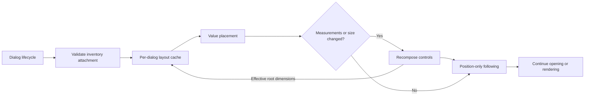
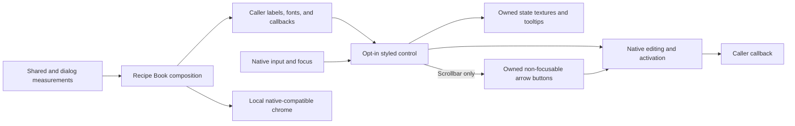

# Recipe Book design

This guide describes the Recipe Book's component ownership, evaluation pipeline, and client UI lifecycle. It is intended for developers maintaining the feature. Player-facing usage is covered in the [README](../README.md).

## Components and authority

- [RecipeBookSession](../VanillaExpanded/src/RecipeBook/RecipeBookSession.cs) owns filtering, sorting, selection, and the published recipe rows for one dialog.
- [CraftingCatalogueView](../VanillaExpanded/src/RecipeBook/CraftingCatalogueView.cs) resolves recipe alternatives and projects evaluated selections. Catalogue metadata is immutable for the loaded world.
- [CraftingAllocator](../VanillaExpanded/src/RecipeBook/CraftingAllocator.cs) evaluates ingredient coverage, craftability, placement support, and grid relevance from captured inventory.
- [GuiDialogRecipeBook](../VanillaExpanded/src/RecipeBook/GuiDialogRecipeBook.cs) binds controls to the session and owns their composition and interaction lifecycle.
- [CraftingTransferCoordinator](../VanillaExpanded/src/RecipeBook/CraftingTransferCoordinator.cs) independently validates and dispatches placement through native inventory transfers.


Displayed eligibility does not authorize a transfer. `CanPlace` permits supported partial ingredient placement; `CanCraft` means the ingredients for one craft are available. Placement always recaptures inventory and validates against live state.

## Filtering and ordering

### Filter ownership

The session explicitly constructs its feature controllers and one [RecipeFilterSet](../VanillaExpanded/src/RecipeBook/RecipeFilterSet.cs). Each controller owns its immutable criteria and registration handle. Filtering has no global registry, discovery mechanism, or public extension API.

| Controller / predicate | Registration identity | Contribution |
| --- | --- | --- |
| [RecipeSearch / SearchFilter](../VanillaExpanded/src/RecipeBook/RecipeSearch.cs) | `vanillaexpanded:search` | Every normalized search term must match the selected recipe's immutable search text. Empty search removes the restriction. |
| [RecipeCategory / CategoryFilter](../VanillaExpanded/src/RecipeBook/RecipeCategory.cs) | `vanillaexpanded:category` | Match the selected recipe's category snapshot, including Other. All removes the restriction. |
| [CraftableOnly / CraftableFilter](../VanillaExpanded/src/RecipeBook/CraftableOnly.cs) | `vanillaexpanded:craftable-only` | Match `Evaluation.CanCraft`. The controller registers its predicate only while enabled. |

All registered [IRecipeFilter](../VanillaExpanded/src/RecipeBook/IRecipeFilter.cs) predicates must match. Predicates read evaluated selections; they cannot capture inventories, allocate ingredients, dispatch transfers, read live stacks or GUI state, mutate other criteria, or reorder rows. Registration order and invocation count have no semantic meaning.

### Registration and updates

`Register(id, filter)` returns an owned registration. Duplicate identities fail before mutation. Its `Replace` operation changes only that registration atomically; idempotent disposal cannot remove a later registration that reuses the identity.

Controller updates commit the registration before changing controller state and invoking the session's common callback. Evaluation and projection have separate responsibilities:

```text
criteria change:
    construct immutable criteria
    commit registration and controller state
    project using existing evaluations

inventory change:
    capture accessible inventory once
    evaluate recipe alternatives once
    project using refreshed evaluations

projection succeeds:
    publish rows and empty-state diagnosis together
```

The filter set enforces its owning client thread and rejects registry mutation or reentrant filtering during an eager projection. Registration and predicate failures propagate without publishing a fallback result. `FilterOthers` evaluates every predicate except the calling registration under the same guarantees; stale handles cannot exclude a newer registration.

To add an internal filtering feature:

1. Implement a pure selection predicate and a controller that owns its criteria and registration.
2. Construct the controller explicitly in the session with the common change callback.
3. Bind controls to the controller. Explicit criteria changes reset recipe scrolling; recomposition restores controls without registering again.
4. Cover predicate behavior, registration failures, allocation reuse, interactions, and resource lifetime with the existing test fixtures.

### Ordering policies

[RecipeSort](../VanillaExpanded/src/RecipeBook/RecipeSort.cs) owns a session-local immutable collection of ordering providers and the selected provider. Each provider defines automatic alternative selection and output-row ordering independently of filter registration. Both orderings finish with ordinal recipe stable identity as a deterministic tie-breaker.

| Policy | Automatic alternative selection | Output-row ordering |
| --- | --- | --- |
| Availability (default) | Supported status, descending grid-kind matches, descending inventory coverage ratio, ascending missing units, stable identity. | Supported status, descending grid-kind matches, craftability, descending coverage ratio, ascending missing units, culture-aware case-insensitive display name, stable identity. |
| Name | Supported status, descending coverage ratio, ascending missing units, stable identity. | Culture-aware case-insensitive display name, stable identity. |

Filtering applies to the resolved alternative, not every alternative in an output group. Availability can therefore select a grid-relevant but incomplete alternative that Hide uncraftable excludes, even when another alternative is craftable. Explicit pins are never substituted to satisfy a filter.

An explicit sort change cancels pending tile presses, ends the interaction freeze, resets scrolling, and reprojects existing allocations. It preserves other criteria, selected output, and pinned alternative. Selecting the active policy is a no-op; unknown identities fail before mutation.

### Interaction reconciliation and empty results

While a recipe is being interacted with, refresh updates evaluations for the displayed recipes while retaining still-eligible rows in relative order. Newly eligible groups append in canonical order. Automatic alternatives may be substituted only when the replacement passes every filter; pins remain explicit. Variant and Auto actions take effect immediately. Ending interaction restores canonical ordering and automatic selection.

Only a completed projection replaces the published rows and empty-state diagnosis. The diagnosis resolves alternatives through the active ordering policy and uses the craftable-only controller's `FilterOthers` pass to distinguish craftability restrictions from search/category restrictions without recapturing inventory.

The empty-state UI binds to the published diagnosis. Its Clear search and Show uncraftable actions update only their owning controllers, preserving unrelated criteria. Clearing search restores search focus. An empty catalogue has no criteria-clearing action.

Hidden selections have disabled footer controls and no recipe tooltip. A hidden pin can survive search and craftable-only changes, subject to normal deselection and category behavior.

## Grid-item relevance

[CraftingInventorySnapshot](../VanillaExpanded/src/RecipeBook/CraftingInventorySnapshot.cs) exposes immutable `GridStacks` from the nine verified crafting input slots. These are references to captured source objects already included in the available supply, not a second inventory read or additional supply.

[GridRelevance](../VanillaExpanded/src/RecipeBook/GridRelevance.cs) groups inputs by native stack identity with quantity normalized to one, preserving meaningful persistent attributes and all source variants within a kind. Ingredient matching uses cloned stacks normalized to the requirement quantity and the same native predicates as allocation.

Relevance is the maximum bipartite matching between distinct input kinds and recipe requirements. Each kind and requirement contributes at most one point. Repeated stacks, grid position, and supplied quantity do not inflate the score.

The allocator publishes immutable `CraftingAllocation.GridMatches` after supported evaluation and required native validation. Availability uses the displayed alternative's own score; Name ignores relevance. A zero score gives no grid-relevance ranking advantage. Relevance is a display hint, not proof of craftability or placement permission.

Criteria changes reuse allocation scores; grid changes refresh through the normal inventory and interaction paths. Evaluation failures leave the prior published rows intact.

## Dialog lifecycle and state

The book belongs to its inventory dialog and closes with that parent. [GuiElementRecipeBookButton](../VanillaExpanded/src/RecipeBook/GuiElementRecipeBookButton.cs) is anchored to the crafting output slot and reflects the book's actual open state. Explicit opening requests search focus; automatic restoration opens without taking focus from the inventory. An unfocused book does not capture keyboard input or acquire focus during resizing.

The [local titlebar adapter](../VanillaExpanded/src/RecipeBook/GuiElementRecipeBookChrome.cs) retains native movement, close controls, hover resources, and two positioning modes:

- **Fixed** uses adaptive inventory-relative placement with a two-screen-pixel docking gap.
- **Movable** uses native dragging and remembered manual coordinates, clamped to the window.

Bounds use window-relative coordinates in both modes. The absence of a native saved manual position means Fixed; choosing Fixed clears that position. Fixed placement is computed from layout, not stored as a separate coordinate.

Recomposition retains the current session, criteria, selection, and scroll while replacing GUI resources. Dialog replacement instead captures immutable [RecipeBookBrowsingState](../VanillaExpanded/src/RecipeBook/RecipeBookBrowsingState.cs) and restores category, exact search text, sort identity, and GUI-unscaled scroll into a fresh session evaluated against current inventory.

| State | Lifetime |
| --- | --- |
| Category, search, sort, and scroll | Retained across dialog reopening/replacement within the loaded world; cleared on world exit or catalogue reinitialization. |
| Allocations, selected outputs, pins, focus, hover, presses, and filter registrations | Current session/dialog only. |
| Craftable-only | Off in each fresh dialog. |
| Reopen with inventory | Native client boolean setting `vanillaexpanded-recipebook-remember-open`, default true. |
| Recipe tile size | Native client integer setting `vanillaexpanded-recipebook-tile-size`, default 45, range 30-90 GUI units. |
| Movable position | Native per-dialog position persistence. |

The first dialog in a world starts with All, empty search, Availability, and zero scroll. Actual open state and browsing state are not persisted across client sessions. Failed opens do not replace the last successfully captured browsing state.

Automatic reopening is independent of browsing-state restoration. Disabling reopening leaves an open dialog and its criteria intact; explicitly closing the book also disables the reopening preference.

## Controls and layout

The dialog contains category tabs and a framed content panel with the selected category's localized heading, filtering controls, search, a recessed recipe list, and footer controls. Minimum dimensions accommodate translated labels, the complete category strip, empty-state actions, and the footer.

Composition and minimum-size measurement use shared named dimensions for spacing, margins, and control chrome. GUI-scaled dimensions are distinct from physical-pixel borders and docking gaps. [RecipeBookLayout](../VanillaExpanded/src/RecipeBook/RecipeBookLayout.cs) owns placement and preferred dialog dimensions; the options component owns popup-width measurement.

The [shared visual helpers](../VanillaExpanded/src/Gui/GuiControlVisuals.cs) expose opt-in palette, frame drawing, control measurement, and host-relative pixel snapping. [Dialog-specific dimensions](../VanillaExpanded/src/RecipeBook/RecipeBookVisualMetrics.cs) govern composition and minimum sizing. [Local chrome adapters](../VanillaExpanded/src/RecipeBook/GuiElementRecipeBookChrome.cs) draw the dialog, titlebar, and recessed list without changing native positioning. The [shared scrollbar](../VanillaExpanded/src/Gui/GuiElementStyledScrollbar.cs) owns scroll-control rendering and maps its pointer interaction to the native scroll range.

Search is the first keyboard tab stop. Native control focus and input routing are preserved, with the category strip acting as one outer tab stop.

### Cached shell layout

The dialog separates attachment validation, cached layout decisions, composition, and position following. Opening initializes layout before refreshing recipes; rendered frames compare current inputs before native rendering. A disposed dialog or zero-sized render surface skips the render lifecycle. A closed inventory, replaced inventory composer, or missing crafting controls closes the book instead of accepting cached geometry.

[RecipeBookLayoutCache](../VanillaExpanded/src/RecipeBook/RecipeBookLayoutCache.cs) belongs to one dialog. It remembers successful measurement inputs and placement geometry, not browsing state or composer-owned mutable bounds. Reopening into a new dialog builds fresh caches. [Shared GUI snapshots](../VanillaExpanded/src/Gui/GuiLayoutInputs.cs) provide scale/language inputs, captured bounds, and value-based placement; tile size and docking dependencies remain recipe-specific.

| Cached decision | Dependencies |
| --- | --- |
| Measurements | Validated tile size, GUI scale, and current/default language snapshots. Catalogue-derived categories and digit width, plus shared font/control definitions, are stable within the dialog. |
| Fixed placement | Window identity and inner dimensions; inventory bounds identity, absolute position, and outer width; crafting grid/output bounds identities and outer rectangles; movement mode, GUI scale, and measured minimum dimensions. |
| Movable size placement | Window identity and inner dimensions; dialog bounds identity and fixed dimensions; movement mode, GUI scale, and measured minimum dimensions. Parent/grid movement and manual x/y are excluded. |

[Language snapshots](../VanillaExpanded/src/Gui/GuiLanguageInputs.cs) track locale, translation service identity, entry-table identity, and line-breaking behavior for both selected and fallback languages. Native reloads replace the entry table, including after lazy invalidation, so same-locale reloads invalidate measurements. Arbitrary in-place mutation of a third-party translation table has no guaranteed invalidation signal.

Changed measurements invalidate placement even when the resulting minimum dimensions stay equal. Placement reuses the existing docking/clamping policy; failures do not retain an earlier success as a fallback. Inventory contents, search, category, sort, and selection update recipe content without invalidating shell measurements or placement.



```text
on open or a valid render frame:
    validate the inventory attachment
    reuse or recompute measurements and placement
    if no placement fits: report insufficient space and close
    if measurements or dimensions changed:
        rebuild controls and record their effective bounds
    if position or window parent changed:
        update the root position using native bounds calculation
    continue opening or native rendering
```

Composition occurs initially or when measured content or dimensions change. Comparing both the last composed size and live root size prevents externally changed root dimensions or clamping from leaving controls with stale geometry. Recomposition retains session criteria and selection, proportional row anchor, recipe inspection, appropriate control focus, and an open options dropdown's text, editing focus, and rejected-edit feedback. Replaced composers release their resources.

Fixed parent movement can invalidate docking and choose another side or size, but does not itself require recomposition. Movable cache hits clamp live manual coordinates without another size-placement calculation. Native titlebar mode switching, dragging, and position persistence remain native-owned.

Position-only following returns without writes or calculation when coordinates and the window parent already match. Necessary movement updates only the root and calls native `CalcWorldBounds` without recursively marking descendants dirty. Initialized children retain local geometry and derive their absolute/render positions from the root, including detached control-owned bounds used for clipping and hit testing. Window replacement updates the root's parent relationship.

This memoizes shell layout, not all GUI work. Native controls may calculate their own bounds during initialization or dragging; content updates and tooltip rendering have separate lifecycles.

### Shared styled controls

The shared GUI layer provides opt-in native-derived controls. Callers supply labels, fonts, bounds, callbacks, and control-specific measurements; the controls have no filtering, catalogue, localization-key, or persistence dependencies. Recipe Book composition supplies its localized labels and controller callbacks to these adapters for search, sorting, both checkboxes, scrolling, footer navigation, and empty-state actions.

| Component | Rendering and ownership |
| --- | --- |
| [GuiElementStyledButton](../VanillaExpanded/src/Gui/GuiElementStyledButton.cs) | Native borderless text and activation, with owned brass idle/hover/pressed backgrounds and a separate muted disabled background. A render-only tracker follows native press/release events; disabled appearance takes precedence over hover and active state. Call its active-state setter through the shared type, not the non-virtual native setter through a base reference. |
| [GuiElementClearableTextInput](../VanillaExpanded/src/Gui/GuiElementClearableTextInput.cs) | Native editing, selection, caret, and focus with a full-field frame, caller-provided placeholder, and owned clear textures and tooltip. Clearing uses the normal text-change callback. Editable bounds account for the native physical-pixel text inset. |
| [GuiElementStyledDropDown](../VanillaExpanded/src/Gui/GuiElementStyledDropDown.cs) and [GuiElementStyledListMenu](../VanillaExpanded/src/Gui/GuiElementStyledListMenu.cs) | Native single-selection and popup interaction at 30-unit selector/row heights. Styled textures remain separate from native recomposition resources and are supplied during rendering. Cached rendering invalidates for relevant label, geometry, scale, and state changes. Width measurement includes the longest label and arrow reservation. |
| [GuiElementStyledCheckbox](../VanillaExpanded/src/Gui/GuiElementStyledCheckbox.cs) | Owned 17-unit flat frame and checked indicator over native toggle interaction. Optional caller-supplied label bounds extend hit testing without changing the square, adding a focus target, or bypassing clipping and disabled state. |
| [GuiElementStyledScrollbar](../VanillaExpanded/src/Gui/GuiElementStyledScrollbar.cs) | Native scroll range, wheel/keyboard handling, and one focus target, with owned track/thumb textures and two owned arrow-button subelements. Caller-supplied bounds, callback, and arrow step keep it independent of the scrolled content. |
| [GuiElementStyledArrowButton](../VanillaExpanded/src/Gui/GuiElementStyledArrowButton.cs) | Native momentary activation on press, with cached idle/hover/pressed/disabled arrow textures. Owns pointer hit testing and press cancellation without adding a keyboard focus target. |

The shared scrollbar accepts a positive finite arrow step in GUI units; native height and scroll-position values remain in physical pixels. Track clicks and thumb dragging map the space between the arrows to the native range. Arrows disable at their limits; fitting content hides the thumb and disables both arrows.

The scrollbar owns its thumb capture and forwards pointer events and lifecycle changes to its arrow buttons. Each button owns its native momentary press state, hit testing, and cached textures; its callback asks the scrollbar to step. Release, focus loss, disabling, and fitting content cancel presses. The buttons are not registered separately with the composer, preserving a single scrollbar focus target.



Native composition and the adapters' additional resources retain separate ownership. Closing or replacing the owning composer disposes both; rendering does not replace global GUI styles or the unrelated native control helpers.

### Category tabs

[GuiElementIconTabs](../VanillaExpanded/src/Gui/GuiElementIconTabs.cs) is a crafting-independent icon tab strip owned by a native child composer. Its equal-width tabs have uniform gaps and no end spacing; the first tab is flush with the panel edge. [GuiElementIconTab](../VanillaExpanded/src/Gui/GuiElementIconTab.cs) retains native toggle interaction and renders rounded-top folder tabs. Selected tabs have a raised upper accent and an open bottom edge joining the framed panel; inactive tabs have lower shoulders. Idle, hover, and selected states have distinct background and icon tints without changing icon geometry.

All appears first. Present standard categories follow Construction, Decorative, Mechanics, Terrain, Tools, Clothing, and Items. Additional categories follow those standards, ordered by localized name with an ordinal category-code tie-breaker; Other appears last when present. This presentation order does not change catalogue membership, filtering, or code-based browsing restoration.

Category selection updates its controller and panel heading and resets recipe scrolling. Localized tooltips and native focus highlighting provide category identification. The Recipe Book reserves width for every tab; the shared component also supports selection wrapping and overflow navigation in narrower hosts.

[RecipeBookCategoryIcons](../VanillaExpanded/src/RecipeBook/RecipeBookCategoryIcons.cs) maps standard categories to monochrome [SVG assets](../VanillaExpanded/assets/vanillaexpanded/textures/gui/recipe-book-categories/); unknown categories use a generic tag. The client owns icon registrations, while each composer owns its rendered textures.

### Search, filtering, and options

[GuiElementClearableTextInput](../VanillaExpanded/src/Gui/GuiElementClearableTextInput.cs) reserves an inner-right clear icon outside the native text/caret area. Recipe Book supplies the Search outputs placeholder and clear tooltip. Its clear action uses the normal search callback and preserves input focus.

Hide uncraftable and the sort selector share one row below the category heading. Clicking either the checkbox or its label toggles the same native control and filter callback. Minimum width includes the checkbox, its label, the selector, and their measured separation. The selector's tooltip carries the localized Sort by label and ordering explanation. Both controls bind directly to their feature controllers; Availability remains the initial order. Recomposition synchronizes controls without invoking change handlers.

[GuiElementRecipeBookOptions](../VanillaExpanded/src/RecipeBook/GuiElementRecipeBookOptions.cs) binds the titlebar's sliders control to the persisted reopening preference and numeric recipe tile size. Valid whole-number sizes from 30 to 90 GUI units apply on the next layout update and persist on the client; the default is 45. Invalid edits retain the last accepted setting and restore it with a localized error on Enter or focus loss. Its dropdown owns its composer and textures, receives input before underlying controls, and dismisses on Escape, outside clicks, or focus loss. Tab traverses the checkbox and numeric input before returning to the outer dialog.

Search, the recessed list frame, and footer actions share horizontal edges. The list reserves its scrollbar internally. Below it, Previous, Auto, and Next form a left group with separate hit regions, the alternative counter is centered, and Handbook is right-aligned. Symmetric width reservations prevent either group from overlapping the counter, including outputs with many alternatives.

### Recipes and handbook

[GuiElementRecipeBookTiles](../VanillaExpanded/src/RecipeBook/GuiElementRecipeBookTiles.cs) uses [shared tile geometry](../VanillaExpanded/src/RecipeBook/RecipeBookTileGeometry.cs) for layout, virtualization, hit testing, previews, quantities, and scrolling. After the dialog reserves scrollbar space, the geometry reserves six units of horizontal padding, fits the maximum number of tiles at the configured size separated by five-unit gaps, and centers the entire column group, including a single column. Tile edges are snapped independently to physical pixels rather than accumulating rounded pitches.

The recipe content starts two GUI units below the viewport's top edge. This leading space scrolls with the content; the full-height viewport clips partially scrolled rows at the list frame's inner edges. Content height, minimum sizing, and keyboard navigation account for the leading space so the first and last recipes remain accessible. Scroll/scrollbar positions clamp together as membership changes. Recomposition maps the first visible recipe and its proportional within-row offset to the new column count and tile size, retaining selection, inspection, and existing tile focus. Size changes also retain an open options dropdown and its editing focus. This transient view anchor does not change the world-local browsing-state format.

Recipe Book composes the [shared scrollbar](../VanillaExpanded/src/Gui/GuiElementStyledScrollbar.cs) with the tile container's scroll callback and one recipe-row pitch as its arrow step. The 12-unit input reservation contains the slimmer visual track without changing the list's clipping region or native scroll range.

Recipe activation validates the output and recipe identities retained by the press; removal or rebinding cancels it. Mouse and keyboard activation share the session's placement path.

Handbook resolves the visible selected output through the native `handbook` link protocol, preserving relevant stack attributes. It does not place ingredients or change recipe selection. Missing selection or preview disables the button; unavailable protocol handling reports a localized error. The inventory and book stay open while the handbook receives focus.

## Rendering and tooltips

### Texture ownership and clipping

Category icons use identical integer raster/display sizes and pixel-snapped positions with nearest magnification. Hover and selection change tint without moving or resizing icons. Tab textures and their clipping rectangle use a common host-relative physical-pixel coordinate system, while native layout and input use the logical viewport. The tab backgrounds share the panel's snapped baseline. Composers dispose their textures when replaced or closed.

Recipe tile backgrounds, icons, and output counts render inside the shared viewport scissor. Scissor scopes unwind on failure. Tile quads, scissors, and pointer hit regions use matching pixel bounds. The dedicated shader draws flat backgrounds and availability outlines: neutral for available recipes, red for missing ingredients, and yellow for partial availability. Unsupported previews use a dark disabled treatment. A separate gold top-left corner indicates selection without obscuring availability or output counts; keyboard focus uses native rendering.

Shared tile geometry defines the centered preview area, native atlas rendering scale, and bottom-right quantity placement. Native item transforms determine each model's silhouette and proportions. Quantities remain independent of selection and availability. Recipe shader overlays and counts render below dropdowns and tooltips; the native focus overlay retains native depth.

[RecipeBookIconCache](../VanillaExpanded/src/RecipeBook/RecipeBookIconCache.cs) is world-owned. It records missing previews during GUI preparation and submits baking requests in the Before render stage through native `RenderItemStackToAtlas`. The cap of four outstanding requests includes both pending and natively queued work. Native atlas rendering owns framebuffer and shader operations; previews can remain pending for two GUI frames.

Texture reload invalidates cached work, and late callbacks release results whose owners no longer exist. Submission failures propagate and leave the request retryable. World cleanup unregisters the renderer and releases its resources.

### Ingredient coverage and inspection

[RecipeBookTooltip](../VanillaExpanded/src/RecipeBook/RecipeBookTooltip.cs) combines the native recipe grid with one compact `have/need name` row per requirement. Coverage describes one craft and comes from authoritative evaluation deficits, so repeated/shared requirements cannot double-count stock. Reusable tools count only when usable under allocation rules.

Exact names use cloned resolved stacks rendered as literal richtext. Wildcard/tag requirements use the localized Matching ingredient label while the grid cycles accepted choices. Counts below requirement use the native error tint. Unsupported or unevaluated selections omit coverage counts.

[GuiElementRecipeBookTooltip](../VanillaExpanded/src/RecipeBook/GuiElementRecipeBookTooltip.cs) caches the semantic summary. Changed counts replace the popup; equivalent summaries retain it. Pointer movement takes precedence over retained tile focus, so leaving a tile hides inspection. Keyboard navigation restores focused-tile inspection until the next pointer movement.

## Verification

Recipe Book tests are separated by their exercised boundary: [Unit](../VanillaExpanded.Tests/Unit/RecipeBook/) covers isolated rules, [Component](../VanillaExpanded.Tests/Component/RecipeBook/) covers composed sessions, dialogs, tiles, and rendering behind mocked external services, and [Integration](../VanillaExpanded.Tests/Integration/RecipeBook/) covers real native compatibility. Shared GUI controls follow the same split across [Unit](../VanillaExpanded.Tests/Unit/Gui/), [Component](../VanillaExpanded.Tests/Component/Gui/), and [Integration](../VanillaExpanded.Tests/Integration/Gui/). The native-transfer suite is Integration coverage, not an E2E client/server workflow. From the repository root:

```powershell
dotnet test .\VanillaExpanded.Tests\VanillaExpanded.Tests.csproj --no-restore --filter "FullyQualifiedName~.RecipeBook.|FullyQualifiedName~.Gui.|FullyQualifiedName~RecipeBookConfigContractTests" --verbosity minimal
```

Native GUI fixtures run without a live game or GPU context. Mocked shader tests cover renderer submission and state management, not GPU compilation or rendered appearance. One-time GPU acceptance is separate evidence, not a permanent regression suite. Use the existing Cake pipeline through `.\build.ps1` to validate JSON, publish the mod, and package its shader/assets.

Package-identified captures at equivalent category, scale, and state support reproducible visual comparisons. Live-world layout, inventory transitions, multiplayer behavior, and recipe/modpack compatibility need in-game validation independently of automated fixtures.
