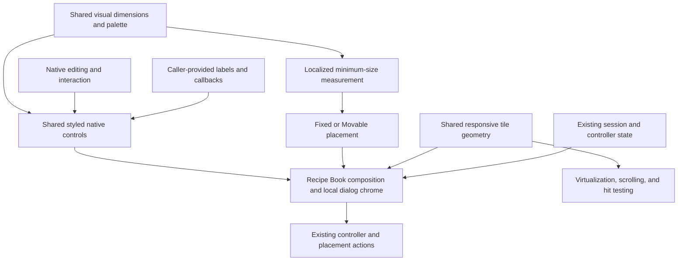

# Recipe Book visual alignment proposal

**Status:** Phase 1 design decisions recorded; implementation pending. Native rendering feasibility and the exact preview inset remain gated. This document does not describe completed implementation.

## Purpose and design authority

Align the Recipe Book with the approved **Design A: attached folder tabs** mockup, including the surrounding panel, controls, and footer. The target is a coherent compact interface, not just the folder-tab silhouette.

The controlling references are:

1. Design A's layout and visual treatment, specified below.
2. The existing feature's ownership, interaction, and persistence contracts in [Recipe Book design](RecipeBook.md).
3. The user's explicit correction: **retain the current Tools icon**. The mockup contains an outdated Tools silhouette and is not authoritative for that asset.
4. Shared, opt-in styled controls, including a reusable clearable text input. Recipe Book semantics remain outside those controls.

The mockup labels recipe tiles and controls as placeholders. This proposal therefore distinguishes direct visual alignment from the user-approved adaptations for real recipes, availability information, localization, and additional categories. The decision disposition below identifies the remaining approval and feasibility gates.

## Scope and invariants

The work covers tab states, category presentation, dialog proportions, compact controls, list layout, recipe-tile presentation, footer grouping, surrounding chrome, and visual verification.

Preserve:

- The current [Tools SVG](../VanillaExpanded/assets/vanillaexpanded/textures/gui/recipe-book-categories/tools.svg) and the other current category assets. No icon artwork replacement is proposed.
- Constant category-icon raster/display size and position across idle, hover, and selection; nearest magnification and physical-pixel alignment.
- Category identity and membership, search semantics, Availability/Name ordering, pinned alternatives, ingredient allocation, and placement authorization.
- Native Fixed/Movable behavior, remembered manual coordinates, inventory ownership, closing with inventory, and the two-screen-pixel docking gap.
- Focus policy, keyboard navigation, explanatory tooltips, popup input precedence, and search clearing.
- Reopening preferences and world-local browsing-state restoration.
- Real item previews, output quantities, the scrollbar, options control, and native movement/close controls.

Styled controls must be reusable, but adoption is limited to the Recipe Book in this work. Do not change global native GUI colors or patch unrelated dialogs. Preserve native interaction through narrow rendering adapters; these must not become replacements for native movement or inventory behavior.

## Visual specification

### Dimensions and typography

Dimensions are GUI/design units unless explicitly identified as physical pixels. Borders and icon coordinates must be rasterized to whole physical pixels at the active UI scale.

| Element | Proposed target |
| --- | --- |
| Dialog width | Preferred baseline of 340; expand for all categories, translated text, and footer requirements. |
| Dialog height | Preferred baseline of approximately 420, with an adaptive recipe viewport. The mockup's three sample rows are not a fixed content limit. |
| Titlebar | 36 high, with 14-unit bold text, followed by a 12-unit gap before the tab strip. |
| Outer content spacing | Eight units inside the outer frame; include border thickness in border-box measurements. |
| Category tabs | 30 wide; 36 high selected and 32 high inactive; four-unit gaps between tabs. First tab aligned with the panel's left edge, without an additional leading inset. |
| Category icons | 20 by 20, stationary across states. |
| Content panel | One-unit outline; eight-unit horizontal/bottom padding and 12-unit top padding. |
| Category heading | 11-unit font, at least 17 units of line space, followed by eight units of spacing. |
| Main control text | 14-unit regular text; use measured font extents for localized labels. |
| Checkbox | 17-unit visual square, vertically centered in the shared filter row. |
| Sort selector | Native-compatible 30-unit height and popup rows, 12-unit text, compact chevron, and restrained horizontal padding; measure the selected options rather than fixing the width. |
| Search | 28-unit minimum height, 14-unit text, eight-unit horizontal text inset, and a ten-unit gap below. |
| Footer | 12-unit regular text, restrained flat controls, eight-unit horizontal button padding, and 12 units of spacing above. |

These targets must be expressed through shared named dimensions and derived measurements. Composition, minimum-size calculation, popup placement, and tooltip bounds must use the same geometry. Minimum dimensions must grow rather than truncate labels or overlap controls.

The native input's clear-icon reservation remains separate from the editable text area. A smaller visual checkbox or chevron must still have a reliable input target.

### Palette and tab states

| Role | Target |
| --- | --- |
| Outer dialog gradient | `#4b4030` to `#3b3226` |
| Outer dialog outline | `#817159` |
| Titlebar gradient | `#65553e` to `#4a3c2c` |
| Titlebar lower separator | `#2a221a` |
| Main text | `#e8ddc5` |
| Panel and selected-tab fill | `#51432f` |
| Panel outline | `#887453` |
| Inactive-tab fill / outline | `#382f23` / `#766349` |
| Hovered inactive-tab fill | `#51422e` |
| Idle / hovered / selected icons | `#b7a98c` / `#fff0cc` / `#f5d58d` |
| Selected-tab outline / upper accent | `#aa8c54` / `#d3b46f` |
| Category heading | `#c8b897` |
| Checkbox fill / outline | `#30291e` / `#948366` |
| Sort-selector fill / outline / text | `#382f23` / `#74634a` / `#d7c8aa` |
| Search fill / outline / placeholder | `#30281e` / `#8c795b` / `#a99b80` |
| List fill / recessed outline | `#352d22` / `#2c251c` |
| Footer text / control fill / outline | `#c9bba0` / `#51412d` / `#756247` |

The selected tab has a separate two-unit upper accent and an open bottom edge that joins the panel. Inactive tabs have lower shoulders and a bottom border matching the panel outline. Hover lightens an inactive background and changes its icon tint; hovering a selected tab retains its selected treatment.

Outline and accent thicknesses scale with the interface, then round to physical pixels. Tab and panel baseline snapping must remain coordinated during dragging and recomposition. Retain native focus appearance and keyboard routing. The strip remains one outer keyboard tab stop with its native focus outline; do not add a custom per-tab focus outline.

The selected fill already matches the proposed panel color. Work should target the remaining differences rather than replace correct rendering indiscriminately.

### Non-tab control states

The following state treatment is approved for shared controls. It changes appearance, not activation semantics or input ownership.

| State | Treatment |
| --- | --- |
| Idle | Use the control-specific fill, outline, and text colors in the palette above. |
| Hover | Outline `#aa8c54`; button and hovered popup-row fill `#51422e`. Search retains its normal fill and typed-text color. |
| Pressed | Button and clear-control fill `#382f23`; do not move or resize their content. |
| Opened dropdown | Fill `#51422e` and outline `#aa8c54`; retain normal selected-value text. |
| Checked checkbox / selected popup indicator | Indicator `#f5d58d`, separate from hover and keyboard focus. |
| Disabled | Text and icons at 35% opacity with the normal frame; no hover or pressed emphasis. Preserve the existing disabled-input contract. |
| Keyboard focus | Retain native focus appearance and routing, including native text-input highlighting. Do not add a competing custom outline or change control geometry. |

Disabled treatment takes precedence over hover and press. Keyboard focus is independently identifiable while checked or opened. Controls use only states applicable to their native behavior; this specification does not add a text-field press action or change when focus is acquired.

## Category presentation

Use the standard order:

**All, Construction, Decorative, Mechanics, Terrain, Tools, Clothing, Items, Other.**

Only show categories present under the existing catalogue rules. Place additional categories after the standard named categories and before Other, sorting those additions by localized display name with an ordinal category-code tie-breaker.

Selection and browsing restoration remain category-code-based. The localized heading and tooltip are presentation, not identity. Ordering the tabs must not change recipe membership or reset a restored category.

Measure the complete strip without leading/trailing tab spacing beyond the panel's own margins. The recipe dialog must show all tabs at once. The shared tab component may retain overflow navigation for narrower hosts elsewhere.

Keep the updated Tools silhouette even when it differs from the mockup. Fixed-size rendering and the new state palette apply to that current asset.

## Shared control architecture

Use native per-instance font and bounds settings wherever they provide the required appearance. Settings alone are insufficient for the proposed flat chrome, so introduce small native-derived rendering adapters in the [shared GUI layer](../VanillaExpanded/src/Gui/). Share palette values and drawing helpers without introducing a general theme framework.

| Shared control | Proposed rendering approach | Retained native responsibility |
| --- | --- | --- |
| Styled text button | Use native borderless rendering for text, with custom flat backgrounds, outlines, and applicable state overlays. | Click handling, keyboard activation, focus, enabled/visible state, and callbacks. |
| Styled clearable text input | Generalize the existing search subclass into the shared GUI layer; replace its embossed chrome and coordinate the field frame, editable area, clear button, and tooltip. | Editing, text selection, caret, text-change notification, and focus. |
| Styled dropdown and popup list | Provide rendering adapters for both the closed selector and expanded list, including the compact chevron, backgrounds, outlines, and state presentation. | Selection, opening/closing, keyboard and mouse navigation, scrolling, and callbacks. |
| Styled checkbox | Replace the embossed frame and checked texture with flat rendering. | Toggle state, mouse/keyboard activation, focus, and callbacks. |

The clearable text input is a general control, not a recipe-search component. Its caller supplies the localized placeholder, clear-tooltip text, font/style inputs, and text-change callback. The component owns the reusable clear-button interaction and tooltip lifecycle; it must not depend on Recipe Book localization keys, catalogue state, filtering, or persistence. Recipe Book composition supplies those labels and connects text changes to the existing search controller.

Apply the shared button treatment to footer and empty-state recovery actions. Use the shared checkbox treatment for both Hide uncraftable and the options popup. The options popup keeps its feature-specific preference handling and input precedence.

The existing [item-stack dropdown](../VanillaExpanded/src/Gui/GuiElementItemStackDropDown.cs) demonstrates replacement of a dropdown's owned popup list. Reuse that ownership pattern, not its item-preview behavior. Existing unrelated consumers remain unchanged.

### Native rendering constraints

- Native button textures and pressed state are private. The approved adapter-owned visual tracker follows native press/release events without replacing activation or callbacks. Callers must use the shared adapter's active-state API, because the native setter is non-virtual.
- Native text-input editing padding is internal, and placeholder rendering is private. Coordinate editable bounds and any custom placeholder presentation so text, selection, caret, and mouse positioning stay aligned at every supported scale; do not rely on inaccessible engine fields.
- Dropdown and popup composition includes private/non-virtual methods, including recomposition when opening or replacing list contents. Custom rendering must remain authoritative after those operations; overriding an initial composition method alone is insufficient.
- Native popup input and scrolling contain fixed 30-unit row assumptions, including a click-boundary check coupled to the selector height. Retain the approved 30-unit selector and popup rows. Compact styling changes fonts, chevron, and chrome, not their input geometry.
- The native focus-overlay method is non-virtual and its visibility is composer-controlled. Retain that rendering and native Tab/Shift+Tab routing; no suppression, custom focus router, or second focus outline is required.

Apply the approved non-tab state treatment above. Shared controls retain native composition ownership and dispose their own additional textures and tooltip resources. No production reflection or global control patching is proposed.

### Native adapter boundaries

The [shared visual helpers](../VanillaExpanded/src/Gui/GuiControlVisuals.cs) provide explicit palette values, generic control measurements, flat/gradient drawing, and host-relative pixel snapping. [Recipe Book visual measurements](../VanillaExpanded/src/RecipeBook/RecipeBookVisualMetrics.cs) keep preferred dimensions and dialog-specific spacing separate from reusable controls. Their availability does not mean the dialog has adopted the new appearance.

- **Button:** compose native borderless text and state textures, with a local flat background behind them. Track press/active state only for background presentation, as explicitly approved; retain native activation and callbacks. Use the shared adapter's active-state setter rather than the non-virtual native setter through a base-typed reference.
- **Text input:** compose native editing and focus textures independently of the full field frame. Translate the editable bounds to account for the native three-physical-pixel text inset. Render caller-supplied placeholder text separately, using the same field inset, without accessing private placeholder or editing fields.
- **Dropdown:** retain native selector/row geometry and selection handling. Replace the protected arrow textures and supply visible popup textures after native opening/list replacement has recomposed them. Production adapters must cache their derived textures and invalidate them when relevant labels, bounds, scale, or state change; the probe's per-render regeneration is not a production rendering strategy.
- **Titlebar:** retain native composition initialization, icon hit regions, movement, close callback, and position persistence. Compose native initialization offscreen, then draw local visible chrome and text/icons at their native coordinates. Native control behavior and hover resources remain owned by the titlebar.
- **Focus:** leave native composition, outlines, and Tab/Shift+Tab handling intact, including the category strip's one outer stop.

[Native-control probes](../VanillaExpanded.Tests/Unit/Gui/GuiControlNativeProbeTests.cs) exercise these boundaries against the installed API references without a live graphics context. [Visual-helper tests](../VanillaExpanded.Tests/Unit/Gui/GuiControlVisualsTests.cs) independently specify the palette and geometry expectations. These fixtures establish source/API feasibility, not final in-game visual acceptance.

## Controls and content composition

### Shared filter row

Place Hide uncraftable on the left and the sort selector on the right of one row, beneath the category heading. Remove the separate visible Sort by row; retain its explanation through the selector's localized tooltip and appropriate control labeling.

Retain **Hide uncraftable** wording and **Availability** as the initial sort policy. The mockup's Craftable only label and Name selection are sample content, not instructions to change those semantics or defaults.

The row must reserve the measured checkbox, label, selector, and separation space. Long translations must expand minimum width rather than overlap. Preserve search-first keyboard tab order and the filter/sort controller callbacks.

### Search and list alignment

Align the search field, recessed list frame, and footer content to the same horizontal edges. Remove the list frame's outward expansion. Reserve scrollbar space inside the revised list geometry.

Compose the shared clearable text input with the search field's warm fill, thin border, text padding, and font hierarchy while retaining native editing, selection, caret rendering, and the clear action. Recipe Book supplies Search outputs wording and the clear tooltip; the mockup's Search recipes placeholder does not require a localization change.

The list must remain a single coherent viewport for layout, virtualization, scrolling, input, and scissoring. Styling changes must not reintroduce an early clipping boundary around inner padding.

### Footer

Use three visual groups:

1. A compact `< Auto >` group on the left.
2. The alternative counter centered in the footer.
3. Handbook on the right.

The navigation group can share one flat outer treatment, but Previous, Auto, and Next retain separate hit regions, enabled states, tooltips, and keyboard activation. Centering the counter must not make it overlap either action group; minimum width must account for the centered layout.

Apply the smaller regular font, warm palette, and measured text padding consistently. Retain the actual alternative counter and Handbook behavior rather than the mockup's sample values.

## Approved recipe-grid adaptations

These adaptations are approved design directions, not a requirement to reproduce the mockup's placeholder objects. The exact preview inset still requires visual approval.

### Responsive tiles and spacing

Use fixed 30-by-30-unit square tiles with five-unit inter-column and inter-row gaps. Choose the largest column count that fits the usable width, then center the complete column group. Spare width becomes equal left/right outer space, not larger tiles or larger gaps. There is no fixed baseline column-count target.

```text
usable width = list interior minus horizontal padding and scrollbar space
columns = largest count that fits 30-unit tiles and 5-unit gaps
group width = columns times 30 plus inter-column gaps
leading space = (usable width minus group width) divided by two
assign whole-pixel tile edges without cumulative rounding drift
derive row pitch, visible rows, and scrolling from that geometry
```

Wider dialogs may show more columns without changing tile size or gap size. A single column is centered too. If no tile fits, retain the existing explicit minimum-size/placement failure instead of shrinking tiles. Layout, virtualization, hit testing, icon quads, quantities, and scrolling must consume the same tile geometry. Resizing must preserve the inspected/selected recipe and restore or clamp scroll using recipe-row position rather than obsolete pixel pitches.

This intentionally retains square game tiles instead of the mockup's stretched rectangles.

### Padding and clipping

Use six units of horizontal list padding, while retaining the full-height inner scissor and no reserved vertical padding strip. Center the column group inside that horizontally padded usable area. The first row reaches the inner top edge, and partially scrolled rows remain visible through the list's inner vertical boundaries.

This intentionally differs from the mockup's six-unit vertical padding to preserve the previously requested list-edge behavior. If literal vertical padding is preferred, it requires separate approval and must not reduce the clipping region to the padded area.

### Availability, selection, and previews

Use quieter one-unit tile outlines with these separate meanings:

- Ordinary available tiles use the warm neutral outline.
- Missing and partially available recipes retain red and yellow availability semantics.
- Unsupported recipes retain their disabled treatment and warning.
- Selection uses a top-left gold corner marker: two eight-unit segments with one-unit strokes, inset three units from the tile edge, colored `#f5d58d`. Keyboard focus remains independently identifiable.

Availability stays on the outer edge. The selection marker leaves that edge and the bottom-right quantity area clear; it must not be confused with partial availability.

Use smaller, centered real item previews with visible breathing room around them. Determine and obtain approval of a consistent inset during visual review; do not replace previews with category silhouettes or suppress output quantities. Continue to use the native item atlas and the existing preparation/render ownership.

The scrollbar, quantities, options icon, and native titlebar controls remain present and receive compatible styling where applicable.

## Outer chrome and integration

Match the title font hierarchy, warm gradients, thin outline, lower titlebar separator, and restrained shadow. Accommodate the existing options icon as well as movement and close controls; the mockup's omission of options is not a removal request.

Prefer native public font, bounds, and composition APIs. Core controls use the shared adapters described above. Where native dialog/titlebar rendering prevents the target appearance, use a Recipe Book-specific chrome adapter that preserves native input and persistence. Do not globally replace titlebars or invent another positioning mode.

Any native restriction that prevents the agreed appearance must be surfaced for approval rather than silently substituted with a different style.



Implementation surfaces:

| Surface | Responsibility |
| --- | --- |
| [Shared GUI layer](../VanillaExpanded/src/Gui/) | Reusable button, clearable text-input, dropdown/popup-list, and checkbox adapters with shared visual helpers. |
| [GuiControlVisuals](../VanillaExpanded/src/Gui/GuiControlVisuals.cs) and [RecipeBookVisualMetrics](../VanillaExpanded/src/RecipeBook/RecipeBookVisualMetrics.cs) | Generic palette/drawing/measurement foundations and separate dialog-specific dimensions. |
| [GuiDialogRecipeBook](../VanillaExpanded/src/RecipeBook/GuiDialogRecipeBook.cs) | Adopt shared controls, supply localized labels and controller callbacks, and compose the shared row, heading, footer groups, measurement, and outer chrome. |
| [RecipeBookLayout](../VanillaExpanded/src/RecipeBook/RecipeBookLayout.cs) | Preferred dimensions and placement within the existing positioning contract. |
| [GuiElementIconTabs](../VanillaExpanded/src/Gui/GuiElementIconTabs.cs) and [GuiElementIconTab](../VanillaExpanded/src/Gui/GuiElementIconTab.cs) | Strip geometry, state palette, accent, outlines, and pixel-aligned panel connection. |
| [GuiElementRecipeBookSearch](../VanillaExpanded/src/RecipeBook/GuiElementRecipeBookSearch.cs) | Source for the shared clearable text-input extraction; remove the feature-specific class after migrating composition and tests. |
| [GuiElementRecipeBookOptions](../VanillaExpanded/src/RecipeBook/GuiElementRecipeBookOptions.cs) | Adopt the shared checkbox while retaining preference handling, popup input precedence, and feature-specific icon/tooltip geometry. |
| [GuiElementRecipeBookTiles](../VanillaExpanded/src/RecipeBook/GuiElementRecipeBookTiles.cs) and [GuiElementRecipeBookTile](../VanillaExpanded/src/RecipeBook/GuiElementRecipeBookTile.cs) | Responsive tile layout, virtualization, scrolling, and interaction geometry. |
| [RecipeBookIconRenderer](../VanillaExpanded/src/RecipeBook/RecipeBookIconRenderer.cs) and [icon shader](../VanillaExpanded/assets/vanillaexpanded/shaders/recipebook_icons.fsh) | Preview inset, availability presentation, selection separation, and quantity placement. |

## Acceptance and verification

Functional test success alone does not establish visual alignment. Acceptance requires both reference-based geometry/style checks and comparable in-game images.

- Verify target palette values, separate hover/selection states, upper accent, scaled border widths, and stationary category icons.
- Verify the shared row, font hierarchy, search/list/footer alignment, complete category strip, and centered footer counter.
- Verify shared-control state rendering, dropdown appearance after opening and list recomposition, clear-input text/caret/selection alignment, and absence of duplicate focus outlines.
- Verify the clearable text input with caller-supplied labels and callbacks independent of Recipe Book state. Clearing must notify through the normal text-change contract without duplicate notifications.
- Verify that footer and empty-state buttons and both checkbox locations use the shared treatment, while unrelated dialogs retain their existing controls and appearance.
- Verify standard and additional category ordering, restored selection identity, long translations, and sufficient minimum dimensions.
- Verify maximum fitting columns, fixed 30-unit tiles and five-unit gaps, centered groups, whole-pixel edge distribution, scroll preservation, partial-row clipping, and quantity visibility.
- Preserve native focus, tooltips, mouse/keyboard actions, Fixed/Movable dragging, reopening, and inventory closure behavior.
- Capture idle, hover, selected, and keyboard-focused states in-game at scales 1, 1.5, and 2, with additional fractional-scale geometry checks.
- Compare reference and game captures at the same selected category and normalized scale. Use real recipe previews and equivalent interaction states when reviewing intentional placeholder departures.
- Cover constrained screen space, additional categories, translated labels, dialog recomposition, and texture/resource disposal.

Update [GUI tests](../VanillaExpanded.Tests/Unit/Gui/) and [Recipe Book tests](../VanillaExpanded.Tests/Unit/RecipeBook/) to assert the approved visual requirements, not merely native colors or internally consistent geometry. Keep expected dimensions and colors independently specified so implementation constants cannot make an incorrect appearance pass automatically.

After implementation, update only affected current-state sections of [Recipe Book design](RecipeBook.md). Reassess the completion item in [project.todo](project.todo); do not claim full alignment until visual acceptance is complete.

### Evidence baseline and destinations

The source baseline is revision `b7050bd2e2722c29e96cc202bbe54a2dc9ae6e2d`, before the Phase 1 documentation changes. Build references resolve through `VINTAGE_STORY=G:\Vintagestory`. The installed game library reports 1.22.7; the API DLL reports 1.22.0. API assembly metadata is not proof of patch-level equivalence with reference source in `D:\CODE\VintageStory\vsapi`; native-risk work must validate the relevant public APIs against the installed binaries.

Preserve the existing Design A reference at `C:\Users\Sisco\.copilot\session-state\d43f7edb-1a48-4194-b923-6ecc0c58fe6d\files\recipe-tab-mockups.html`. Its SHA-256 is `AF3D8D79E59C2FB7321FF76B6FB7D0D4D97DA4F012DD6DFA454A1CF97DF8EDEF`. The current Tools SVG SHA-256 is `38D30686F27E32A9BCB4AA537B8BA9326D477923C42EC2CFEFA5C4496FF5AC41`; the other current category assets also remain authoritative and unchanged.

The retained session checkpoint `023-proposing-recipe-book-visual-a.md` reports 229 passing focused GUI/lifecycle/movable-geometry tests under the IconValidation configuration. This is historical functional evidence, not a new test run, proof of the approved appearance, or confirmation of the currently loaded mod package. Missing evidence includes the shared-control states and extraction, native focus/composition seams, centered 30-unit grid, updated shell geometry, and normalized live captures at the required scales.

The agreed destination for required reference copies, captures, package/version identification, and acceptance results is `C:\Users\Sisco\.copilot\session-state\d43f7edb-1a48-4194-b923-6ecc0c58fe6d\files\recipe-book-visual-alignment`. Create it when evidence is produced; retain that evidence during final cleanup. No acceptance package has been built or identified by Phase 1. Final live evidence must name the tested package and client/API versions rather than infer runtime contents from repository source. No separate implementation diary or audit report is required.

## Decision disposition

| Decision | Disposition |
| --- | --- |
| Grid sizing and spare width | Approved: fixed 30-unit square tiles, five-unit gaps, maximum fitting columns, entire group centered. |
| List padding and clipping | Approved: six-unit horizontal padding, no reserved vertical strip, full-height inner scissor. |
| Availability and selection | Approved: one-unit outer status outlines retaining red/yellow meanings, plus the specified inset top-left gold corner marker. |
| Real previews | Inset direction approved; exact inset remains blocked on later rendered visual review and approval. |
| Non-tab control states | Approved as specified above. |
| Local titlebar/dialog rendering adapters | Permitted subject to Phase 2 native feasibility; no global patching or production reflection. |
| Focus appearance | Retain native appearance and keyboard routing; no custom focus outline or router. |
| Button visual state | Approved: a render-only press/active tracker with native activation and callbacks; callers use the shared adapter's active-state API. |
| Dropdown height | Retain native-compatible 30-unit selector height and popup rows; no compact-height coordinate adapter. |
| Popup/native composition constraints | Explicit Phase 2 feasibility gates; unresolved restrictions must return for approval before dependent implementation. |
| Acceptance evidence destination | Approved: the session evidence directory above, retained with required captures and results. |

The current Tools icon is **not** an open decision: it must be retained.

## Exclusions

No new recipe features, filtering policies, sort defaults, positioning modes, persistence formats, icon artwork, or inventory-transfer behavior are proposed. Do not copy mockup sample recipes, quantities, category selection, or counter values into the application.
