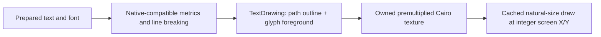

# Text drawing and rendering-path catalog

This catalog describes how VanillaExpanded renders text and distinguishes mod-owned drawing from native controls and game-owned artwork.

## Shared renderer

[`TextDrawing`](../VanillaExpanded/src/Gui/TextDrawing.cs) owns direct Cairo text painting and transparent text-texture generation. It uses the selected `CairoFont` and preserves the caller's drawing state and current path.

Outlined text is painted in two passes:

```text
position the outline at the native whole-pixel baseline
stroke the glyph path using the outline color and width
return to the same baseline
paint the foreground with Cairo's glyph renderer
```

The foreground uses `ShowText`, not a filled `TextPath`. `RenderTwice` repaints the foreground at the same baseline without changing the font weight or position.



`TextDrawUtil.Lineize` supplies native-compatible layout for word wrapping, explicit newlines, and line alignment; `TextDrawing` owns the painting. Auto-boxed textures use native-compatible dimensions and rounded outline padding. Explicitly sized textures use the caller's dimensions, orientation, and padding. Callers own texture filtering, caching, and screen placement.

## Sizing and outlines

[`CairoTextSizing`](../VanillaExpanded/src/Gui/CairoTextSizing.cs) fits fonts before rasterization, never by resampling completed textures. Outline policy belongs to the caller:

- HUD indicator outlines default to, and cannot shrink below, 1.5 physical pixels during indicator sizing or fitting. Every fitting candidate is measured with the minimum applied; GUI scale does not multiply the minimum.
- Immersive environmental-thermometer and calendar readings have no outline.
- Other callers use proportional outline fitting unless they supply a minimum.

## VanillaExpanded-owned drawing paths

These entry points paint mod-owned text through `TextDrawing`.

| Entry point | Text surfaces | Current rendering |
| --- | --- | --- |
| [`TextElement.CreateTexture`](../VanillaExpanded/src/HudOverlays/Rendering/Native/TextElement.cs) | HUD readings, text-style names/values, immersive environmental temperature, calendar month/day, and edit-placeholder lettering | Auto-boxed or explicitly aligned texture with HUD filtering, fitting, clipping, and element-owned caching. |
| [`RadialMenuRenderer.DrawLabel`](../VanillaExpanded/src/RadialMenu/RadialMenuRenderer.cs) | Radial entry labels and wrapped center labels, including tool-mode selection labels | Cached textures with circle fitting and integer natural-size draws. |
| [`RadialProgressBarRenderer`](../VanillaExpanded/src/RadialProgress/RadialProgressBarRenderer.cs) | Auto-stashing/auto-looting progress captions | Explicitly sized, centered textures with cached labels and integer natural-size draws. |
| [`HudOverlayGroupTitleBar.ComposeTextElements`](../VanillaExpanded/src/HudOverlays/Interaction/HudOverlayGroupTitleBar.cs) | HUD group captions | Direct drawing into the clipped caption surface. |

The shared HUD texture path is consumed by [`TextView`](../VanillaExpanded/src/HudOverlays/Rendering/Native/TextView.cs), [`IconReadingView`](../VanillaExpanded/src/HudOverlays/Rendering/Native/IconReadingView.cs), [`ThermometerView`](../VanillaExpanded/src/BodyTemperature/ThermometerView.cs), [`WetnessView`](../VanillaExpanded/src/PlayerWetness/WetnessView.cs), [`ArrowView`](../VanillaExpanded/src/BowAmmunition/ArrowView.cs), [`ClimateView`](../VanillaExpanded/src/EnvironmentalTemperature/ClimateView.cs), [`CalendarView`](../VanillaExpanded/src/CalendarDate/CalendarView.cs), and [`EditProxyView`](../VanillaExpanded/src/HudOverlays/Rendering/Native/EditProxyView.cs). These views do not require separate rasterizers.

[`TextMetrics`](../VanillaExpanded/src/HudOverlays/Rendering/Native/TextMetrics.cs), `CairoTextSizing`, and [`RadialMenuLabelLayout`](../VanillaExpanded/src/RadialMenu/RadialMenuLabelLayout.cs) measure or fit text; they do not paint it. Supplied integration/headless text factories remain responsible for their own pixels.

## Delegated native-control rendering

Native controls own their internal text rasterization. `TextDrawing` does not intercept or patch these paths.

| VanillaExpanded entry point | Delegated text surfaces |
| --- | --- |
| [`HudOverlayHoverLabels`](../VanillaExpanded/src/HudOverlays/Rendering/HudOverlayHoverLabels.cs) | Native hover-text background and rich-text label/value lines. |
| [`HudOverlayTogglePopup`](../VanillaExpanded/src/HudOverlays/Interaction/HudOverlayTogglePopup.cs) | Static toggle/style/size labels and native action-button text. |
| [`HudOverlayStyleDropDown`](../VanillaExpanded/src/HudOverlays/Interaction/HudOverlayStyleDropDown.cs) | Native selected-value text. |
| [`HudOverlaySizeInput`](../VanillaExpanded/src/HudOverlays/Interaction/HudOverlaySizeInput.cs) | Native number-input text, editing, and placeholder rendering. |
| [`HudOverlayListMenu`](../VanillaExpanded/src/HudOverlays/Interaction/HudOverlayListMenu.cs) | Native list-row rich text and composed list surface. |
| [`GuiElementItemStackDropDown`](../VanillaExpanded/src/Gui/GuiElementItemStackDropDown.cs) | Native alloy selection text; the custom item icon is rendered without a stack-size label. |
| [`GuiElementItemStackListMenu`](../VanillaExpanded/src/Gui/GuiElementItemStackListMenu.cs) | Native alloy list-row text; custom item icons are rendered without stack-size labels. |
| [`GuiDialogAlloyCalculator`](../VanillaExpanded/src/Gui/GuiDialogAlloyCalculator.cs) | Native dialog title, static ingredient/section labels, slider values, target input, increment/decrement/deposit buttons, dynamic waste/temperature text, fuel rich text, and hover tooltips. Item-preview components also delegate item tooltips and any stack-size lettering to the engine. |

Customizing these internal surfaces requires mod-local controls or supported composition overrides. VanillaExpanded does not modify base-game text-rendering methods.

## Borrowed artwork

[`ToolModeSkillIcon`](../VanillaExpanded/src/ToolModeRadialMenu/ToolModeSkillIcon.cs) receives game-owned `SkillItem.Texture` artwork and optional `RenderHandler` callbacks. These can contain lettering, but VanillaExpanded does not generate those pixels. Borrowed textures use integer placement and artwork scaling, not font fitting.

Item-stack artwork and slideshow components likewise remain engine-owned. Their textures cannot be rerasterized through `TextDrawing` without ownership of the original text and font.
