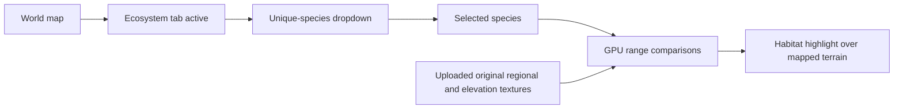
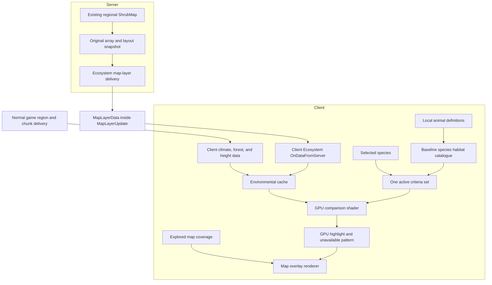
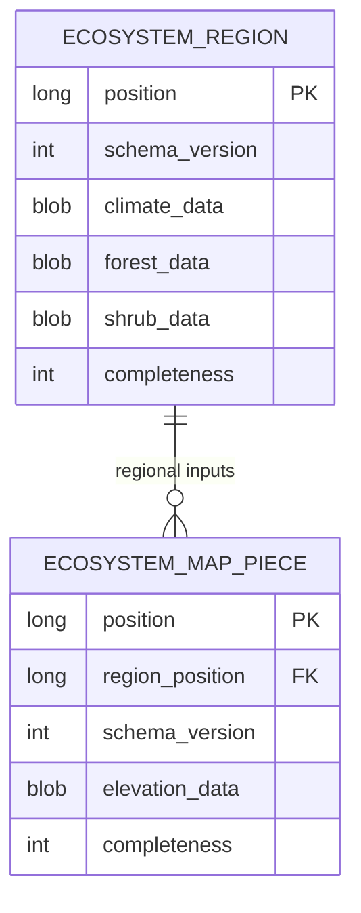

# Ecosystem map overlay proposal

Implementation checklist: [EcosystemMap.todo](EcosystemMap.todo).

Status: client-side GPU habitat evaluation with server-supplied original shrub arrays and omission of backfill approved; remaining design decisions are for review. This document describes the intended behavior and proposed integration boundaries. It is not an implementation checklist.

## Intended result

Add an **Ecosystem** toggle tab to the world map. While active, it displays a dropdown of unique wild animal species. Selecting a species highlights the mapped areas whose regional environment satisfies that species' habitat requirements.

The highlight uses world-generation temperature, rainfall, forest density, shrub density, and elevation. It communicates suitable habitat rather than sightings or the presence of living animals.

The agreed scope is:

- Show the Ecosystem controls and habitat highlight only on the full world map; exclude the minimap.

- Include all naturally spawning wildlife species defined by local game and mod assets, with one dropdown entry per species combining age, sex, and cosmetic variants.
- Exclude fish, insects, supernatural creatures, and domestic-only variants. Mod-added wildlife participates through the same discovery and exclusion rules.
- Omit backfill. Capture environmental coverage from data available during normal play, including already loaded areas, and persist it for later use.
- Evaluate regional environmental requirements using worldgen temperature, rainfall, forest density, and shrub density, with terrain elevation checked separately. Current weather and seasonal climate do not drive habitat eligibility.
- Suppress surface columns classified as ocean by the native terrain map category, using captured surface classification rather than an elevation cutoff or rendered pixel colors. This exclusion does not extend to freshwater.
- Otherwise ignore water, ground, clearance, light, population caps, player distance, and spawn chance.
- Use the existing map layer system with client-side GPU habitat evaluation and persistence. Receive the server's original regional shrub arrays through the existing map-layer transport; this requires a server component for shrub delivery.
- Use client-local animal definitions as the baseline catalogue. A supplemental server-supplied catalogue is deferred to a follow-up.

## Player interaction

The Ecosystem tab follows the existing map's toggle-layer behavior. Its dropdown is visible while the tab is active. The selected species controls one translucent highlight, with terrain, landmarks, and other map layers remaining readable.

Changing the selection uses cached environmental data locally. Panning or zooming prepares highlights from cached data and any normally received world data available for the displayed mapped area. It does not request remote environmental backfill. Rendering samples uploaded environmental textures and performs the comparisons on the GPU, without world queries or CPU-generated suitability grids.

Proposed presentation behavior:

- Sort species by their localized display names and retain the current selection while the map is recomposed or reopened within the session.
- Render highlights only over explored map coverage, even when environmental records cover a larger region.
- Render a red crosshatched pattern overlay over explored areas whose required environmental data is unavailable. Areas with complete data that fail the habitat predicate receive neither the habitat highlight nor the unavailable-data pattern. Clip both overlays to explored coverage and show them only on the full map while the Ecosystem tab is active. Replace the pattern with the evaluated result when the required data becomes available.
- Keep the dropdown attached to the full world map, following the existing extra-panel mechanism. Render the habitat highlight only in the full map, even when the Ecosystem layer is active while the minimap is visible.

## Verified integration points

Inspection of the installed game assemblies established the following behavior. These findings describe the inspected version; they should be checked against the target game version during implementation.

| Integration point | Observed behavior | Consequence |
|---|---|---|
| `WorldMapManager.RegisterMapLayer` and `LayerGroupCode` | Registered layer groups supply map toggle tabs. | Ecosystem can be a normal map layer. |
| `MapLayer.ComposeDialogExtras` | Layers can supply an extra GUI composer; the world map enables it with the corresponding tab. | The species dropdown can follow the prospecting layer's existing pattern. |
| `MapLayerData` | Contains a registered layer code and an opaque byte-array payload. | Route original shrub-array payloads to the Ecosystem layer. |
| `MapLayerUpdate` | Carries an array of `MapLayerData` messages. | Reuse this envelope for shrub delivery without a new outer packet type. |
| `MapPieceDB` | Stores rendered terrain pixels. | Saved map images do not retain the original elevation or climate arrays. |
| `MapDB.SetMapPieces` | Replaces the serialized row when a terrain tile is saved. | Extra fields appended to the vanilla record would need preservation patches. |
| Client region packets | Supply climate and forest maps, but omit shrub maps. | Send the server's existing shrub map separately, preserving its array and layout metadata. |
| Client map chunks | Supply rain and world-generation terrain heightmaps. | Elevation can be captured while map chunks are available. |
| Client entity packets | Supply entity identity and variants, but omit server spawn conditions. | Use local animal assets for the baseline catalogue; packet omission does not establish that those assets are unavailable. |

The [prospecting layer](../../../../vssurvivalmod/Systems/Prospecting/OreMapLayer/OreMapLayer.cs) demonstrates dropdown composition and map-layer data delivery. The shared contracts are available in [SpawnConditions.cs](../../../../vsapi/Common/Entity/SpawnConditions.cs), [IMapRegion.cs](../../../../vsapi/Common/API/IMapRegion.cs), and [IMapChunk.cs](../../../../vsapi/Common/API/IMapChunk.cs).

## Species catalogue and habitat rules

Build the catalogue by discovering animal species from client-local game and mod definitions, including locally available asset patches. Verify access to patched assets and reuse of the game's variant resolution; fully resolved spawn conditions on client runtime entities are not assumed. Define stable species identities independently of localized names and individual entity codes.

Local knowledge is the baseline and does not depend on a server catalogue. Server-only changes may differ from that baseline. A supplemental server-supplied catalogue is deferred to a follow-up; its protocol, precedence, and reconciliation rules are outside the initial implementation.

For animals such as deer, retain the species `type` and combine `age` and `gender` variants. Names such as Elk, Caribou, and Fallow Deer remain separate species entries. Some included families need explicit normalization: chickens encode sex in their age variants. Combine cosmetic variants under their species identity as well. A generic entity-code suffix removal is insufficient.

Discover species from definition metadata and semantic variants; do not maintain a hardcoded supported-species or source-file list. Do not classify every land entity as wildlife or assume every `type` variant represents a separate species. The catalogue includes naturally spawning animal species from local game and mod assets. Exclude fish, insects, supernatural creatures, and domestic-only variants. Apply the same metadata exclusions to mod-added animals; local patches remain applicable. Definitions may supply species-group metadata to merge breed/cosmetic types; species without such metadata remain automatically discoverable. Reuse vanilla creature-name localization or an existing native group-name key instead of adding feature-owned species translations.

The catalogue retains species definition provenance. The renderer receives exactly one active set of min/max environmental ranges for the selected species. The GPU does not receive a species catalogue or arrays of spawn alternatives. Species switching updates comparison uniforms while reusing source textures. Do not silently union differing definitions into a wider interval; the controls supply ongoing-spawn ranges when available, falling back to worldgen ranges. Within that path, select a representative by ordinal entity code; never merge differing ranges.

The environmental predicate covers:

| Input | Comparison |
|---|---|
| Regional temperature | Minimum and maximum temperature |
| Regional rainfall | Minimum and maximum rainfall |
| Forest density | Minimum and maximum forest density |
| Shrub density | Minimum and maximum shrub density |
| Forest or shrubs | `max(forest, shrubs) >= MinForestOrShrubs` |
| Elevation | Minimum and maximum normalized elevation |

Use the game's elevation convention: below sea level, `y / seaLevel`; above sea level, `1 + (y - seaLevel) / (worldHeight - seaLevel)`. The exact terrain sample and surface offset must be consistent with the selected habitat semantics.

### Regional climate semantics

The World API exposes efficient regional climate lookup, but calling `GetClimateAt` at the surface is not automatically equivalent to animal habitat evaluation.

The inspected runtime animal spawner evaluates climate at a reference height of approximately `seaLevel * 1.09`, then checks actual elevation separately. Worldgen spawning uses a similar reference for temperature, but reads rainfall differently. Client and server temperature conversion also have different lower clamps. Reuse the appropriate game conversion and sampling conventions rather than the player's displayed temperature.

Use worldgen environmental values for habitat eligibility. The inspected base-game animal definitions retain the default `ClimateValueMode.WorldGenValues`; temperature matching reads `WorldGenTemperature`, and ongoing spawning samples generated forest and shrub maps. Spawning during world generation and spawning during ongoing play both use generated environmental values. They are not alternative sources of seasonal or current-weather data.

The single active criteria set uses one sampling convention consistent with its definition. Perform sampling, climate conversion and the actual comparisons in the GPU shader. Do not introduce a worldgen/runtime mode selector or evaluate multiple alternatives in the shader.

The client climate lookup can return placeholder values when regional data is missing. Validate source availability explicitly; placeholders and absent shrub data must never become valid habitat samples.

## Client-side environmental acquisition

Use normally received climate, forest, and elevation data alongside client-local animal definitions. Receive the original shrub-density array from the server's existing `IMapRegion.ShrubMap`, then cache it on the client. Habitat evaluation and rendering remain client-side.

Do not reconstruct shrub maps locally or duplicate the vanilla generator's initialization and orchestration calls. The inspected vanilla code splits that orchestration between `GenMaps.initWorldGen()` and the private `OnMapRegionGen(...)`; it does not expose a standalone shrub-map operation with a client-compatible context. Moreover, forced climate changes can occur after shrub generation, so the transmitted climate map is not always the original shrub-generator input.

The server component reads the existing regional shrub map rather than generating a replacement. The payload preserves the region coordinates, original integer array, map size, top-left padding, and bottom-right padding, together with a payload version. Preserve the original values and sampling layout rather than sending a resampled approximation.

Missing shrub data remains unavailable until received or recovered from this world's cache. Do not substitute zero density or a locally regenerated array. The initial feature therefore requires server shrub-delivery support to populate uncached shrub coverage. This dependency is separate from the deferred server species catalogue and does not change installation requirements for unrelated mod features.

## Data ownership and transport

Keep registration thin. Species classification, environmental acquisition, server shrub delivery, storage, habitat evaluation, and presentation each have a separate owner. The renderer consumes original GPU textures and one active comparison range set, and does not own persistence or species policy.

Use `SendMapDataToClient` and the layer's `OnDataFromServer` callback for the versioned shrub payload. `MapLayerData` provides routing; `MapLayerUpdate` provides the existing envelope. The feature owns decoding, completeness checks, and persistence. Capture the server array safely before asynchronous serialization, and avoid resending unchanged regions unnecessarily.

Coordinate shrub delivery with regions supplied during ordinary exploration, including relevant regions already loaded when the feature initializes. Delivery must not depend solely on opening the Ecosystem tab. Map-open and view-change callbacks can supplement this flow for available regions; they must not load or generate remote regions to fill missing ecosystem coverage. The precise delivery hook remains an implementation detail to verify. If requests are needed, account for the fact that the inspected `OnDataFromClient(byte[])` callback omits sender identity, whereas server map-open and view-change callbacks receive the player.

Persist normally received inputs and the original shrub maps for use after regions unload. Missing climate or elevation remains unavailable; shrub delivery alone cannot recover those inputs from old saved map images.

The species catalogue continues to use client-local animal definitions. A supplemental server catalogue remains deferred to a follow-up; original shrub delivery is part of the initial implementation and does not introduce catalogue synchronization.

Ocean suppression uses independently available per-column semantic categories from normally loaded client chunks. Observe normal chunk notifications and map-chunk arrivals, and inspect currently loaded data on a background worker using the native rain-height/fluid-or-solid/snow-step surface rules and resolved terrain category lookup. The image generator has no standalone category operation and depends on map-open image queues; do not invoke it for ecosystem data or copy its shading/decorating loop. Use canonical parchment surface semantics in color-accurate mode as well. Unknown classification stays distinct from known non-ocean. Persist classification alongside independently arriving heights and suppress confirmed ocean before any habitat or unavailable-data output, including when height/climate/vegetation are absent. These captures do not depend on opening the Ecosystem tab.

## Persistence in a dedicated ecosystem database

Maintain a separate client-local SQLite database file owned by the Ecosystem feature and scoped to the current server/world identity. The feature owns its connection, schema, transactions, and lifecycle. Do not open, modify, or extend vanilla's map database file, connection, tables, or `MapPieceDB` serialization.

Store environmental data at its natural granularity: climate and vegetation arrays once per region, with elevation and tile-specific completeness per map piece. Preserve array size and padding metadata alongside the original values. Concrete type, table, and file names remain implementation choices.

Both tables belong exclusively to the ecosystem database. Tile coordinates associate environmental records with displayed terrain in memory; there is no cross-database join or foreign-key dependency on vanilla's map tables. Partial records may exist while other inputs are arriving.

Vanilla terrain redraws and pixel-record replacement do not affect ecosystem records. The stored environmental inputs remain reusable when the player selects another species. Persist normally received climate, forest, and elevation as well as separately delivered shrubs; vanilla's in-memory environmental arrays are not retained by its pixel cache.

Serialize database access through the feature's storage owner, perform disk work off the render thread, and use bounded transactions. Incoming data is queued as safe snapshots. Captured climate, forest, shrub, and elevation inputs, their layout metadata, and completeness records are persistent data; pending writes for these records must be flushed on normal world exit before closing the connection. GPU input-preparation jobs and GPU presentation resources are disposable data that can be cancelled or discarded and rebuilt from persisted inputs. Stop acquisition before the final flush so no new writes arrive after storage closes. Keep records isolated between server/world identities. Explicit cache purge intentionally discards persisted records and pending writes, as described below.

Coordinate ecosystem cache clearing with map purge without accessing vanilla's database: clear the feature's own records, pending writes, and derived highlights. Continue clipping highlights to currently explored map coverage. Version environmental records explicitly, and invalidate derived highlight tiles when inputs or the habitat catalogue change. Avoid storing an independent permanent mask for every species when it can be rebuilt from shared environmental inputs.

## Coverage, backfill, and historical compatibility

Capture and persist environmental data as areas become available through ordinary play, so the overlay continues working after their world chunks unload. Acquisition should not depend solely on the Ecosystem tab being open. Also capture relevant regions and map chunks already loaded when the feature initializes.

**Backfill** means obtaining missing environmental inputs for areas already drawn in the saved map before this feature captured them, without requiring the player to revisit those areas. For example, a distant valley may remain visible as a saved map image while its climate and height arrays are no longer available locally. The pixel-only image cannot reconstruct those inputs. Receiving a shrub array alone does not recover missing climate or elevation.

Without backfill, existing worlds remain usable: areas available during normal play gain ecosystem coverage, and revisiting an old mapped area supplies its inputs through normal game loading. Once captured, that coverage persists across travel and reconnects. Old uncached areas remain visible on the ordinary map but have unavailable ecosystem coverage until their required inputs become available. Panning over an old map image alone does not load those inputs.

**Historical shrub-generation compatibility** requires no client reproduction of old algorithms: the server supplies the shrub array already held by the region, including historical or server-specific results. For an unloaded old region, capture its shrub record when the region becomes available through normal play.

Approved scope: omit backfill. Do not add server-side retrieval of saved world-region records, remote region loading, or terrain generation to fill missing environmental coverage for old map-only areas. Reading previously captured records from the local ecosystem database is permitted and is required for reuse across sessions. Background processing may read and cache original environmental inputs for GPU upload; it does not trigger world loading to obtain missing inputs.

Clip the highlight to explored coverage even when a cached regional array extends beyond it.

## Performance and lifecycle expectations

Prepare bounded original-input bundles for upload, share regional GPU textures and retain tile-specific height/coverage textures. The GPU evaluates the selected ranges and generates the mask/highlight. Species switching updates uniforms without rebuilding input textures. Acquire missing textures before one shared graphics pass per full-map render; capture/setup/restore caller state and bind common uniforms once, updating only tile inputs and changed regional bindings inside the pass. Zoom changes presentation scale rather than selecting a CPU sampling density.

Choose sampling density against habitat-boundary accuracy, particularly where elevation changes rapidly. Avoid marking a whole chunk suitable from a single centre sample. Exact sampling resolution, cache limits, and batch sizes require measurement rather than fixed speculative budgets.

Snapshot original arrays before asynchronous local reads/upload preparation where game-owned arrays or API access cannot safely be shared. Upload and release rendering resources on the appropriate client thread. Closing the map stops unnecessary presentation work without discarding pending environmental writes. On normal world exit, cancel disposable evaluation and presentation work, flush captured environmental records, then close storage and clear world-specific state, following the persistence lifecycle above.

## Validation expectations

Validation should demonstrate local catalogue construction and use without any server catalogue message, locally patched definitions and variant resolution, species deduplication across age, sex, and cosmetic variants, automatic discovery of local game and mod wildlife, exclusion of fish, insects, supernatural creatures, domestic-only variants, GPU comparison of the single selected criteria set, boundary handling, independence from current weather and seasonal climate, and unknown-data behavior. Compare representative results with the inspected game habitat calculations, including reference-height climate and normalized elevation.

Exercise persistence across tile redraw, map close/reopen, region unload, reconnect, purge, and version changes. Verify server/world isolation, persistence of pending environmental writes on normal shutdown, cancellation of disposable work, intentional record and pending-write removal on purge, and that ecosystem storage never opens or modifies the vanilla map database. Verify that panning over old uncached map images does not trigger server-side retrieval of saved world-region records or world loading, that previously captured local ecosystem records can still be read after reconnecting, and that ordinary revisiting populates and retains ecosystem coverage. Confirm that server shrub arrays survive transport and persistence with unchanged values, size, padding, and region identity. Verify missing-server-support and missing-record behavior, correct routing to the Ecosystem layer, and that old map images without environmental records remain distinguishable from unsuitable habitat. Include a region with forced climate changes to ensure the existing shrub array is delivered rather than recomputed from the final climate map.

Measure map opening, panning, species switching, cache size, and client environmental capture and server shrub delivery with representative explored maps. Focused automated checks cannot establish visual quality or live performance. In-game acceptance should confirm readable terrain, correct dropdown visibility, stable highlights, and no reveal beyond mapped coverage. In a mixed-coverage view, confirm that unavailable mapped areas show red crosshatching, confirmed habitat mismatches remain unmarked, and suitable areas show the habitat highlight. Verify that the crosshatching disappears as required inputs become available and that neither overlay appears on unexplored terrain, on the minimap, or while the Ecosystem tab is inactive. Verify that neither Ecosystem controls nor habitat highlights appear on the minimap, including while the layer is active and after closing the full map.

## Decisions remaining before an implementation plan

Database ownership is settled: use a dedicated client-local ecosystem database. No further product-scope decisions are currently identified; concrete storage and lifecycle hooks remain implementation details to verify.

## Evidence references

The analysis used local API and survival-mod source plus targeted decompilation of the installed `VSEssentials.dll` and `VintagestoryLib.dll`. Relevant installed symbols are:

- `WorldMapManager`: layer registration, tab grouping, network envelopes, and receive dispatch.
- `GuiDialogWorldMap`: tab activation and extra-composer visibility.
- `MapLayerData`, `MapLayerUpdate`, and `MapLayer`: transport envelope and layer callbacks.
- `ChunkMapLayer`, `MapDB`, and `MapPieceDB`: client-local cache, tile replacement, and pixel-only persistence.
- `ClientWorldMap.GetClimate` / `GetClimateAt`: cached sampling and placeholder fallback.
- `ClientMapRegion.UpdateFromPacket`, `ClientMapChunk.UpdateFromPacket`, and `EntityTypeNet`: actual client data availability.
- `ServerSystemEntitySpawner.GetSuitableClimateTemperatureRainfall` and `GenCreatures`: habitat sampling conventions.
- `GenMaps.initWorldGen`, `GenMaps.OnMapRegionGen`, and `GenMaps.ForceClimate`: server-dependent orchestration and climate modification after shrub generation.
- `ServerMapRegion` and `ClientMapRegion`: original shrub-map ownership and omission from normal region packets.

The temporary decompiled analysis files are not repository dependencies. Durable API references include [climate conversion](../../../../vsapi/Common/Climate.cs), [world lookup contracts](../../../../vsapi/Common/API/IBlockAccessor.cs), [server world-manager access](../../../../vsapi/Server/API/IWorldManagerAPI.cs), and [SQLite connection behavior](../../../../vsapi/Common/IO/SQLiteDBConnection.cs).
