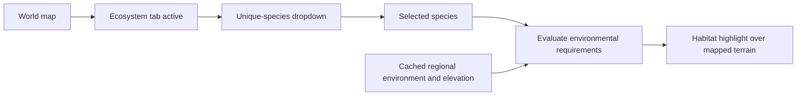
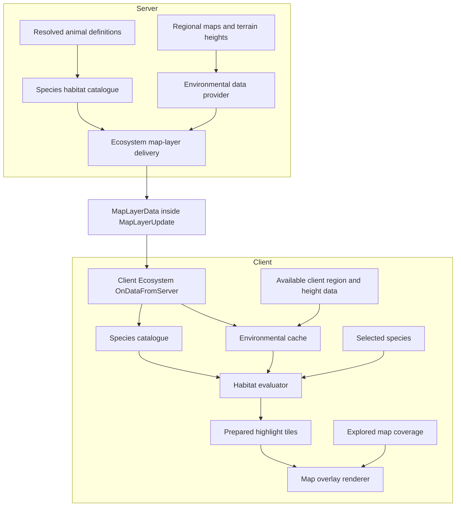
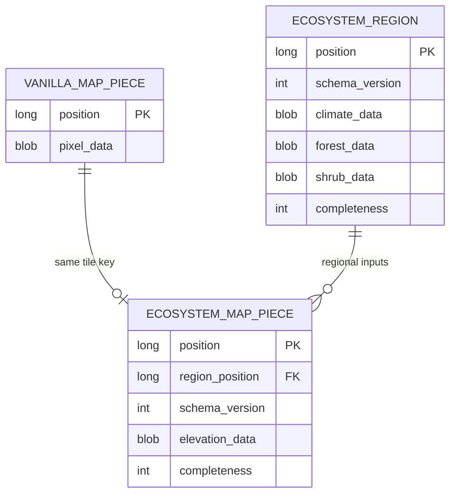

# Ecosystem map overlay proposal

Status: proposal for review. This document describes the intended behavior and proposed integration boundaries. It is not an implementation checklist.

## Intended result

Add an **Ecosystem** toggle tab to the world map. While active, it displays a dropdown of unique wild animal species. Selecting a species highlights the mapped areas whose regional environment satisfies that species' habitat requirements.

The highlight uses world-generation temperature, rainfall, forest density, shrub density, and elevation. It communicates suitable habitat rather than sightings or the presence of living animals.

The agreed scope is:

- One dropdown entry per unique species, combining age and sex variants.
- Exclude fish.
- Evaluate regional environmental requirements only.
- Ignore water, ground, clearance, light, population caps, player distance, and spawn chance.
- Reuse the existing map layer and map networking systems.

## Player interaction

The Ecosystem tab follows the existing map's toggle-layer behavior. Its dropdown is visible while the tab is active. The selected species controls one translucent highlight, with terrain, landmarks, and other map layers remaining readable.

Changing the selection uses cached environmental data locally. Panning or zooming requests or prepares any missing data for the newly displayed mapped area. Rendering consumes prepared highlight textures rather than performing world queries each frame.

Proposed presentation behavior:

- Sort species by their localized display names and retain the current selection while the map is recomposed or reopened within the session.
- Render highlights only over explored map coverage, even when environmental records cover a larger region.
- Distinguish unavailable environmental data from a confirmed habitat mismatch. A short loading or unavailable indication in the layer panel can provide this distinction without colouring unexplored terrain.
- Keep the dropdown attached to the full world map, following the existing extra-panel mechanism. Minimap highlighting remains a decision for review.

## Verified integration points

Inspection of the installed game assemblies established the following behavior. These findings describe the inspected version; they should be checked against the target game version during implementation.

| Integration point | Observed behavior | Consequence |
|---|---|---|
| `WorldMapManager.RegisterMapLayer` and `LayerGroupCode` | Registered layer groups supply map toggle tabs. | Ecosystem can be a normal map layer. |
| `MapLayer.ComposeDialogExtras` | Layers can supply an extra GUI composer; the world map enables it with the corresponding tab. | The species dropdown can follow the prospecting layer's existing pattern. |
| `MapLayerData` | Contains a registered layer code and an opaque byte-array payload. | Environmental messages fit the existing transport envelope. |
| `MapLayerUpdate` | Carries an array of `MapLayerData` messages. | No new outer network packet is required. |
| `MapPieceDB` | Stores rendered terrain pixels. | Saved map images do not retain the original elevation or climate arrays. |
| `MapDB.SetMapPieces` | Replaces the serialized row when a terrain tile is saved. | Extra fields appended to the vanilla record would need preservation patches. |
| Client region packets | Supply climate and forest maps, but omit shrub maps. | Complete habitat evaluation needs supplemental server data. |
| Client map chunks | Supply rain and world-generation terrain heightmaps. | Elevation can be captured while map chunks are available. |
| Client entity packets | Supply entity identity and variants, but omit server spawn conditions. | Supply a compact habitat catalogue from the server. |

The [prospecting layer](../../../vssurvivalmod/Systems/Prospecting/OreMapLayer/OreMapLayer.cs) demonstrates dropdown composition and map-layer data delivery. The shared contracts are available in [SpawnConditions.cs](../../../vsapi/Common/Entity/SpawnConditions.cs), [IMapRegion.cs](../../../vsapi/Common/API/IMapRegion.cs), and [IMapChunk.cs](../../../vsapi/Common/API/IMapChunk.cs).

## Species catalogue and habitat rules

Build the catalogue from the server's resolved entity definitions so effective asset patches are reflected in the habitat limits. Define stable species identities independently of localized names and individual entity codes.

For animals such as deer, retain the species `type` and combine `age` and `gender` variants. Names such as Elk, Caribou, and Fallow Deer remain separate species entries. Some families need explicit normalization: chickens encode sex in their age variants, while butterflies encode species, sex, colour, and seasonal forms together. A generic entity-code suffix removal is insufficient.

Use a narrowly owned species mapping for supported animals. Do not classify every land entity as wildlife or assume every `type` variant represents a separate species. The exact catalogue, including treatment of insects and support for mod-added animals, requires review; fish are excluded regardless.

Each species entry contains the relevant environmental limits and the entity identities from which they were derived. Where one species genuinely has multiple habitat rule sets, preserve those alternatives. A sample matches if it satisfies a complete applicable rule set; do not merge separate ranges into a larger interval that invents suitable habitat between them.

The environmental predicate covers:

| Input | Comparison |
|---|---|
| Regional temperature | Minimum and maximum temperature |
| Regional rainfall | Minimum and maximum rainfall |
| Forest density | Minimum and maximum forest density |
| Shrub density | Minimum and maximum shrub density |
| Forest or shrubs | `max(forest, shrubs) >= MinForestOrShrubs` |
| Elevation | Minimum and maximum normalized elevation |

Use the game's elevation convention: below sea level, `y / seaLevel`; above sea level, `1 + (y - seaLevel) / (worldHeight - seaLevel)`. The exact terrain sample and surface offset must be consistent with the selected habitat semantics.

### Regional climate semantics

The World API exposes efficient regional climate lookup, but calling `GetClimateAt` at the surface is not automatically equivalent to animal habitat evaluation.

The inspected runtime animal spawner evaluates climate at a reference height of approximately `seaLevel * 1.09`, then checks actual elevation separately. Worldgen spawning uses a similar reference for temperature, but reads rainfall differently. Client and server temperature conversion also have different lower clamps. Reuse the appropriate game conversion and sampling conventions rather than the player's displayed temperature.

Worldgen and runtime habitat definitions must remain distinguishable in the catalogue until the evaluation policy is agreed. A reasonable proposal for this general habitat overlay is to include locations satisfying either applicable environmental rule set. This is a recommendation for review, not a settled requirement, and does not imply an extra player-facing mode selector.

The client climate lookup can return placeholder values when regional data is missing. Validate source availability explicitly; placeholders and absent shrub data must never become valid habitat samples.

## Data ownership and transport

Keep registration thin. Species classification, environmental acquisition, storage, habitat evaluation, and presentation each have a separate owner. The renderer consumes prepared results and does not own persistence or species policy.

`MapLayerData` handles routing, not environmental structure or persistence. Define a versioned payload for catalogue and environmental messages and serialize it into its `Data` field. The receiving ecosystem layer updates its own cache.

Use the normal map-open and view-change callbacks to serve relevant areas. These server callbacks include the player identity. The inspected `OnDataFromClient(byte[])` dispatch does not forward the sender, so request/reply behavior that needs player identity must not assume that callback provides it. Additional request details should be designed around the available callbacks before committing to a protocol.

The server supplement is needed for the effective species rules and shrub maps. Environmental fields already available on the client can be captured there. Whether delivery supplies only missing fields or complete environmental records is an implementation tradeoff; both feed the same cache and evaluator.

The mod currently allows servers without Vanilla Expanded. Propose enabling Ecosystem only when the server provides the required feature capability, without changing the installation requirements of unrelated features.

## Persistence in the existing map database

Propose additional, namespaced tables in the existing client-local world-map SQLite database. Keep vanilla `MapPieceDB` serialization intact.

Conceptually, the extension consists of `MapPartExt` environmental records. Store their data at its natural granularity: regional climate and vegetation once per region, with elevation and tile-specific completeness per map piece. Concrete type and table names remain implementation choices.

The relationships above describe logical association, not a requirement to alter vanilla tables or introduce database foreign-key constraints. Partial records may exist while other inputs are arriving.

Vanilla tile regeneration constructs a fresh pixel-only record and replaces its row. A separate table allows environmental information to survive redraws without patching every vanilla serialization path. The stored environmental inputs remain reusable when the player selects another species.

The existing map database uses WAL mode, but its connection is privately owned by the terrain layer. Implementation must choose between controlled integration with that owner and a separately owned connection to the same file. Either choice must respect connection threading, bounded transactions, shutdown, and database recreation. WAL alone does not provide application-level coordination.

Integrate cache clearing with map purge: the vanilla purge deletes only its map-piece rows. Version environmental records explicitly, and invalidate derived highlight tiles when inputs or the habitat catalogue change. Avoid storing an independent permanent mask for every species when it can be rebuilt from shared environmental inputs.

## Coverage and previously explored areas

Capture and persist environmental data as areas become available, so the overlay continues working after their world chunks unload. Acquisition should not depend solely on the Ecosystem tab being open; otherwise normal exploration would leave avoidable holes in its cache.

Previously explored areas are a distinct migration case. Their existing map images contain pixels, not reconstructable climate or height arrays. Full initial coverage therefore requires reading the corresponding saved server region and map-chunk records.

The public world-manager getters return loaded records. A lightweight saved-record retrieval path has not yet been established. Do not present immediate backfill of all existing map coverage as verified, and do not substitute generating or loading full terrain columns as an assumed solution.

Two possible initial behaviors remain for review:

- Backfill existing explored tiles through a verified saved-record retrieval path.
- Populate environmental coverage as areas are revisited, showing older uncached coverage as unavailable until then.

Neither approach can reconstruct missing inputs from the map image itself. Incoming regional data must still be clipped to explored coverage when rendered.

## Performance and lifecycle expectations

Evaluate bounded batches of visible map samples, reuse regional arrays, and cache prepared highlight tiles. Selecting another species invalidates the derived highlight rather than reloading the environmental source data. Zooming may require a different presentation resolution, but does not change the underlying habitat predicate.

Choose sampling density against habitat-boundary accuracy, particularly where elevation changes rapidly. Avoid marking a whole chunk suitable from a single centre sample. Exact sampling resolution, cache limits, and batch sizes require measurement rather than fixed speculative budgets.

Snapshot data before background evaluation where game-owned arrays or API access cannot safely be shared. Upload and release rendering resources on the appropriate client thread. Closing the map stops unnecessary presentation work; world exit closes storage and clears world-specific state.

## Validation expectations

Validation should demonstrate species deduplication, fish exclusion, complete environmental-rule matching, boundary handling, and unknown-data behavior. Compare representative results with the inspected game habitat calculations, including reference-height climate and normalized elevation.

Exercise persistence across tile redraw, map close/reopen, region unload, reconnect, purge, and version changes. Confirm that environmental messages reach the registered layer and that old cached images without environmental records remain distinguishable from unsuitable habitat.

Measure map opening, panning, species switching, cache size, and server data acquisition with representative explored maps. Focused automated checks cannot establish visual quality or live performance. In-game acceptance should confirm readable terrain, correct dropdown visibility, stable highlights, and no reveal beyond mapped coverage.

## Decisions remaining before an implementation plan

1. Final species catalogue, including insects and the boundary for mod-added species support.
2. Whether habitat eligibility combines worldgen and runtime environmental rules or follows one selected convention.
3. Initial support for previously explored areas: saved-record backfill or progressive coverage on revisiting.
4. Whether the ecosystem highlight also appears on the minimap.
5. Database connection ownership and the saved-record retrieval path, after targeted technical verification.

## Evidence references

The analysis used local API and survival-mod source plus targeted decompilation of the installed `VSEssentials.dll` and `VintagestoryLib.dll`. Relevant installed symbols are:

- `WorldMapManager`: layer registration, tab grouping, network envelopes, and receive dispatch.
- `GuiDialogWorldMap`: tab activation and extra-composer visibility.
- `MapLayerData`, `MapLayerUpdate`, and `MapLayer`: transport envelope and layer callbacks.
- `ChunkMapLayer`, `MapDB`, and `MapPieceDB`: client-local cache, tile replacement, and pixel-only persistence.
- `ClientWorldMap.GetClimate` / `GetClimateAt`: cached sampling and placeholder fallback.
- `ClientMapRegion.UpdateFromPacket`, `ClientMapChunk.UpdateFromPacket`, and `EntityTypeNet`: actual client data availability.
- `ServerSystemEntitySpawner.GetSuitableClimateTemperatureRainfall` and `GenCreatures`: habitat sampling conventions.

The temporary decompiled analysis files are not repository dependencies. Durable API references include [climate conversion](../../../vsapi/Common/Climate.cs), [world lookup contracts](../../../vsapi/Common/API/IBlockAccessor.cs), [server world-manager access](../../../vsapi/Server/API/IWorldManagerAPI.cs), and [SQLite connection behavior](../../../vsapi/Common/IO/SQLiteDBConnection.cs).
