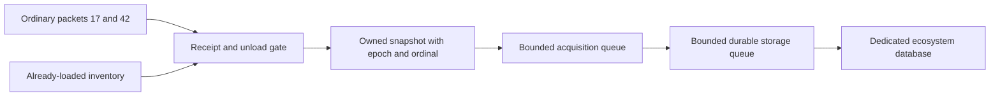

# Environmental acquisition and shrub delivery

`EcosystemMapSystem` registers `EcosystemMapLayer` as `vanillaexpanded:ecosystem` on both sides. The layer routes shrub payloads through vanilla's world-map envelope. It starts inactive; source capture and persistence run independently of map visibility. Its map-group label uses the vanilla language domain.

## Client receipt

`ClientReceiptAdapter` installs checked Harmony boundaries around installed `SystemNetworkProcess.ProcessInBackground` and `SystemUnloadChunks.HandleChunkUnload`. It locks only packet 17 (map chunk), packet 42 (map region), and the unload boundary using a feature-owned gate. This protects the ordinary map-chunk dictionary while `Start` copies the already-loaded inventory. The region inventory is the client's concurrent dictionary. No source objects or game-owned arrays enter the queues.

Packet 17 captures the completed generated terrain heights and coordinates. Packet 42 captures the actual climate/forest arrays after insertion, before vanilla's deferred region event. Capturing there retains receipt-time provenance even if a queued region event runs after purge. Initial regional keys undo vanilla's signed-X regional index addition; initial tile positions use vanilla's map-size-based chunk-index conversion.

`EnvironmentalSnapshots` checks each original array and its sampling layout independently and copies its logical square cells. Vanilla network decoders may retain backing arrays larger than Size × Size; unused capacity is excluded from the snapshot, while arrays shorter than the logical map remain unavailable. Missing arrays, empty placeholders and invalid layouts remain unavailable. The client never obtains environmental samples through climate APIs that supply fallback values. Shrubs arrive separately.

The gate is released before bounded queue admission. Each capture retains its original storage epoch and a monotonically increasing receipt ordinal. Component-specific ordering prevents an older startup snapshot from overwriting a newer packet when submissions interleave outside the gate. Climate, forest and shrubs retain independent arrival order. Generated terrain heights and ocean classifications are independently ordered per tile.

The session currently permits one waiting record in each queue, in addition to executing work and the finite startup inventory snapshot. This is a conservative serialization bound, not a measured throughput setting. Source callbacks can experience backpressure; representative gameplay measurements are still needed to tune acquisition throughput. Disk operations execute only on the storage worker.

## Ocean surface classification

`OceanCaptureSource` observes normal `ChunkDirty` notifications and completed map-chunk arrivals. It schedules coordinate/epoch/ordinal requests only on notifying threads. One background worker captures the already-loaded inventory at startup and after a successful purge, plus normal arrivals and changes while the map/tab is closed. Up to 128 distinct pending notification keys are coalesced; overflow becomes one finite loaded-inventory scan instead of dropped coverage or unbounded waiting tasks. This count is provisional, not measured throughput evidence. No request loads chunks or generates map images.

`NativeOceanClassifier` uses the loaded native terrain layer's public resolved `block2Color` and `colorsByCode` tables, including modded blocks assigned `ocean`. It snapshots the category lookup and follows the native surface selection: original rain-height column, normally loaded client chunks, `UnpackAndReadBlock` with `FluidOrSolid`, and exactly one downward step for a snow surface. It does not reproduce shading, lake-edge decoration or map pixels. The native complete image-generation loop is map-open dependent and has no standalone surface-category operation, so observing it alone would miss tab-closed capture. The selector uses the same canonical parchment surface semantics in color-accurate mode; display texture/color settings do not change ocean eligibility. Missing/incompatible native categories disable only classification with an error; missing native terrain produces a warning. Neither case substitutes an elevation or RGB heuristic.

Worker lookups/snapshots share the receipt/unload gate; thread-safe native block reads and disposed/loaded checks prevent removed chunks from becoming known land. Game-owned arrays and chunks never enter capture/storage queues. Individual unresolvable surfaces remain unknown. Snapshot synchronization ends before bounded acquisition admission. Session shutdown detaches and joins this worker before stopping receipt capture and draining persistent writes; a worker failure cannot skip the storage drain.

## Original server shrubs

`ServerShrubSource` observes `ConnectedClient.SetMapRegionSent`, the normal server-send marker used for central regions, neighbours and forced ordinary resends. It records exact connection identities and regional keys before the ecosystem layer or player must be ready. On the server owner thread, a 50 ms listener seeds already-sent sets for existing connections and drains observed obligations after layer initialization and the player's Playing state.

The source reads only `IWorldManagerAPI.GetMapRegion`, which returns loaded regions. It copies the existing `ShrubMap` without accessing climate or invoking a generator. A region whose climate was forced after shrub generation therefore retains its original shrub values. An unavailable region is not retrieved: another ordinary send observation can establish a new obligation.

`ShrubDelivery` stores a 64-bit FNV-1a content hash over coordinates, layout and original array values per sent region and connection, avoiding unchanged transmissions on ordinary resends. Changed original arrays or layout produce a new payload. Disconnect clears pending keys and hashes immediately and prevents reseeding the departing connection before vanilla removes it. Reconnect uses a new connection generation. A successful client purge sends a versioned cache-reset notification only when the optional control channel reports server support. The handler uses its authenticated player argument, clears only that connection's revision suppression, and re-seeds its already-sent set on the next tick. This covers normal sends racing the notification; all reads still use loaded-only GetMapRegion. No coordinates or player identifiers are accepted in the reset message. Shutdown clears all delivery state and removes owned patches/listeners.

## Payload and routing

Wire version 1 consists of little-endian 32-bit integers: wire version, region X, region Z, component version, size, top-left padding, bottom-right padding, value count, then the original integer values. The regional coordinate space is the ordinary two-dimensional map space. The component version is independent of the wire version. No resampling or density conversion occurs.

Decode validates supported versions, positive square layout, exact byte length and padding before accepting a component; allocations are bounded by the supplied message length. `WorldMapManager.SendMapDataToClient` creates `MapLayerData` inside `MapLayerUpdate`; the registered ecosystem layer's `OnDataFromServer` validates and submits shrubs to acquisition. Environmental arrays continue to use only this envelope. The separate cache-reset notification carries no environmental request, coordinates or catalogue.

Missing server support leaves uncaptured shrubs unavailable while normally received climate, forest and height data remain usable in this world's local cache. Map-open, map-close and view-change callbacks issue no retrieval requests. Panning old map images never loads or generates a region.

## Purge and exit

`EcosystemClientSession` opens storage only with verified world identity and geometry, then attaches the existing map purge command and starts initial capture. It owns [GpuHabitatPreparation](HabitatEvaluation.md), resets it on purge and exposes `Purged` for other disposable consumers. A successful purge advances the storage epoch, clears environmental records and invalidates queued old capture jobs. Late producers retain their old epoch and cannot restore cleared state.

Layer shutdown, LeaveWorld and mod disposal share idempotent cleanup: stop and join ocean intake, stop receipt intake, detach the command binding, join disposable preparation, join accepted capture jobs, drain durable writes, close storage, remove owned receipt patches, and clear world-owned state. Constructor failure also stops intake, restores a command wrapper already attached, and closes storage.

Headless tests cover same-connection purge, unchanged shrub reacquisition and notification suppression on unsupported servers or failed vanilla purge. They exercise installed packet insertion, regional array updates, map-envelope routing, command purge and server send markers. Concurrent unload testing substitutes the voxel-unload body with its map-dictionary removal while retaining the real method's adapter prefix/finalizer; a separate test preserves the real unload exception path. These checks establish the tested adapter and persistence contracts, not live terrain rendering or gameplay performance.
