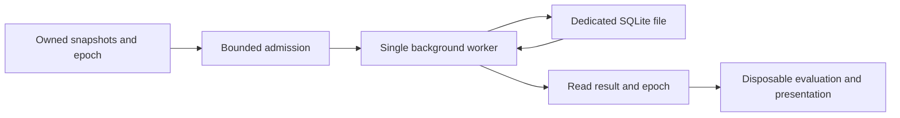

# Environmental storage

`EcosystemMap/Storage` owns immutable environmental snapshots and a separate client-local SQLite database. `EnvironmentalStorage` is the admission and lifetime owner; `EcosystemDatabase` performs synchronous SQL exclusively on its background worker. Neither component receives a vanilla map database handle or accesses vanilla map files.

## Persistent records

`EcosystemStorageIdentity` requires the globally unique save identifier, world dimensions, sea level, region size and chunk size. The file is `ModData/vanillaexpanded/ecosystem/<sha256-save-identifier>.db` beneath the supplied game data directory. Stored identity and geometry must match before records are usable. Dimensions and integer coordinates identify rows; tile-to-region association uses coordinates in this database alone.

`ecosystem_region` stores climate, forest and original shrub arrays once per region. Each component preserves its signed integer values, size and both padding values. Components arrive independently: an omitted component retains an existing valid snapshot. `ecosystem_map_piece` stores each chunk's unsigned terrain elevations separately. Snapshots copy their inputs and expose read-only values. Completeness describes available inputs; it does not assert habitat suitability.

Schema, record and component formats are explicitly versioned. Missing, incompatible or malformed components remain unavailable rather than becoming samples. Unknown schemas fail opening; there is no migration, historical backfill, remote retrieval or world generation. Local reads only retrieve previously captured data.

## Ordering and lifetime

The caller chooses queue capacity for its acquisition workload and awaits submissions for backpressure. One worker serializes reads and updates. Each write transaction contains one regional or tile record; purge uses one transaction to clear both environmental tables. Disk work never executes on a render callback. No measured throughput or final acquisition queue budget is implied by this component.

Every producer and read result carries a `StorageEpoch`. Consumers check `IsCurrent` before publishing derived results and observe the epoch's disposable-work cancellation token. Evaluation results, prepared tiles and textures belong to their presentation owners and are not persisted by storage.

Normal shutdown closes admission, cancels disposable work, drains accepted persistent operations and closes the connection. It preserves the persistent generation so accepted writes remain durable. Later producers are rejected. Synchronous and asynchronous disposal join the same shutdown task.

Purge advances the epoch before admitting a clear barrier. Old queued writes are discarded; any already executing write precedes the clear. New-epoch writes cannot overtake that barrier. Completed old reads and late producers become invalid, preventing cleared data from reappearing. Cancellation callbacks run outside admission locks and SQL transactions.

`EcosystemMapPurgeBinding` attaches to the existing `.map purgedb` command after vanilla creates it. It forwards the original arguments and result, clears ecosystem storage and invokes the derived-state cleanup callback only after vanilla reports success. Disposal restores the prior command handler only while the binding still owns it. Its checked private-field adapter is specific to the inspected game version. [EcosystemClientSession](EnvironmentalAcquisition.md) attaches this binding during ordinary acquisition startup and exposes its purge notification to disposable consumers. It stops receipt intake and joins copied capture jobs before asking storage to drain and close.