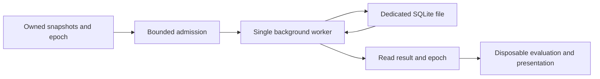

# Environmental storage

`EcosystemMap/Storage` owns immutable environmental snapshots and a separate client-local SQLite database. `EnvironmentalStorage` is the admission and lifetime owner; `EcosystemDatabase` performs synchronous SQL exclusively on its background worker. Neither component receives a vanilla map database handle or accesses vanilla map files.

## Persistent records

`EcosystemStorageIdentity` requires the globally unique save identifier, world dimensions, sea level, region size and chunk size. The file is `ModData/vanillaexpanded/ecosystem/<sha256-save-identifier>.db` beneath the supplied game data directory. Stored identity and geometry must match before records are usable. Dimensions and integer coordinates identify rows; tile-to-region association uses coordinates in this database alone.

`ecosystem_region` stores climate, forest and original shrub arrays once per region. Each component preserves its signed integer values, size and both padding values. Components arrive independently: an omitted component retains an existing valid snapshot. `ecosystem_map_piece` stores each chunk's unsigned terrain elevations and independent ocean classification. Snapshots copy their inputs and expose read-only values. Completeness describes available inputs; it does not assert habitat suitability.

Schema, record and component formats are explicitly versioned. Regional database rows use version 2 and tile rows use version 3; the table schema remains version 1. Both accept only current compressed records. Incompatible rows remain unavailable until ordinary acquisition replaces them; there is no migration or legacy reader. A partial arrival cannot recover omitted components from an incompatible row. Unknown schemas fail opening. Local reads only retrieve previously captured data, with no historical backfill, remote retrieval or world generation.

Each regional component and tile blob is compressed independently by the built-in DeflateStream at CompressionLevel.Optimal. EnvironmentalCompression owns this database-only envelope; the shared raw serializer and version-1 shrub wire payload remain uncompressed and unchanged. Decompression recovers every original signed map integer and unsigned height bit. The raw tile layout contains optional elevations and an optional two-bit-per-column ocean grid (unknown, known non-ocean, ocean). Partial arrivals merge independently; missing classification is never fabricated.

The envelope has a 20-byte little-endian header: magic VED1 (identifying this Deflate format), decoded byte length, compressed byte length and a 64-bit FNV-1a checksum over decoded bytes. Reads require matching lengths, exact bounded decompression with no extra output and a matching checksum before constructing records. The checksum detects accidental damage; it does not authenticate data. Decoded payloads are limited to 64 MiB per blob on both writes and reads; tile reads additionally enforce their world's maximum serialized chunk size. These are format safety limits, not measured gameplay cache budgets. Missing, incompatible or malformed components remain unavailable. A damaged optional ocean component in an otherwise valid raw tile layout remains unavailable independently of elevations.

## Ordering and lifetime

The caller chooses queue capacity for its acquisition workload and awaits submissions for backpressure. One worker serializes reads and updates. Each write transaction contains one regional or tile record; purge uses one transaction to clear both environmental tables. Disk work never executes on a render callback. No measured throughput or final acquisition queue budget is implied by this component.

Every producer and read result carries a `StorageEpoch`. Consumers check `IsCurrent` before publishing derived results and observe the epoch's disposable-work cancellation token. [GpuHabitatPreparation](HabitatEvaluation.md) owns disposable original-input bundles for GPU upload; rendering resources belong to presentation. None are persisted by storage. Successful commits notify GPU input preparation for targeted source/bundle invalidation.

Normal shutdown closes admission, cancels disposable work, drains accepted persistent operations and closes the connection. It preserves the persistent generation so accepted writes remain durable. Later producers are rejected. Synchronous and asynchronous disposal join the same shutdown task.

Purge advances the epoch before admitting a clear barrier. Old queued writes are discarded; any already executing write precedes the clear. New-epoch writes cannot overtake that barrier. Completed old reads and late producers become invalid, preventing cleared data from reappearing. Cancellation callbacks run outside admission locks and SQL transactions.

`EcosystemMapPurgeBinding` attaches to the existing `.map purgedb` command after vanilla creates it. It forwards the original arguments and result, clears ecosystem storage and invokes the derived-state cleanup callback only after vanilla reports success. Disposal restores the prior command handler only while the binding still owns it. Its checked private-field adapter is specific to the inspected game version. [EcosystemClientSession](EnvironmentalAcquisition.md) attaches this binding during ordinary acquisition startup and exposes its purge notification to disposable consumers. It stops receipt intake and joins copied capture jobs before asking storage to drain and close.
