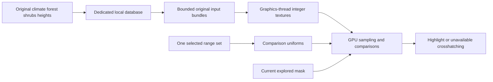

# GPU habitat evaluation

The CPU captures and persists original environmental arrays, reads immutable local snapshots and uploads integer textures. It does not sample terrain columns into suitability grids or generate overlay pixels. `GpuHabitatPreparation` owns bounded local reads and reusable upload bundles; `GpuHabitatOverlay` runs the comparison shader on the graphics thread.

## One selected criteria set

`HabitatRanges` contains one active min/max pair for temperature, rainfall, forest, shrubs and elevation, plus MinForestOrShrubs and one sampling convention. `From(HabitatRule)` copies an explicitly chosen definition set. It does not union ranges, combine alternatives or send species/rule arrays to the GPU. Species selection changes comparison uniforms while retaining environmental textures. The catalogue retains definition provenance separately; the controls prefer ongoing-spawn ranges, fall back to worldgen ranges, and select a representative by ordinal entity code within the chosen path.

## GPU sampling and output

Regional textures preserve original signed 32-bit climate/vegetation values in R32I. Heights use R16UI; explored coverage uses R8UI. Regional textures can be shared across terrain tiles; tile textures own heights and mutable coverage. Nearest filtering and texelFetch leave interpolation to the shader, which respects each source map's size and padding.

The shader samples generated maps with the active set's worldgen or ongoing-spawn convention. It uses the server temperature clamp, reference-height rainfall conversion, generated terrain height plus one, and normalized elevation. CPU-provided reference-height integers and conversion scale are world metadata, not per-column evaluation. The shader performs all habitat comparisons.

A known mismatch discards the fragment. Missing required inputs produce crosshatching; complete matching inputs produce the highlight. An unexplored column is discarded before comparison. The backend supplies display colors and retains the map scissor; the backend requires fullMapActive before drawing. Normalized elevation limits are converted once per criteria/world-geometry change into inclusive integer surface-height bounds using the server double-precision convention. The GPU samples terrain height plus one and compares it with those bounds, avoiding float division at elevation thresholds. This converts scalar criteria only; no terrain columns are sampled on the CPU.

## Ownership and validity

`GpuHabitatPreparation` has no species input. Its off-view cache floors are eight regional snapshots, 128 elevation records and 128 lightweight upload bundles. During rendering, retention expands to fit every currently visible explored chunk and its distinct regions, preventing still-visible inputs from being evicted at wider zooms. Admission remains four queued read jobs plus one executing job. Closing the map shrinks input retention back to the configured floors. Representative workload tuning and GPU resource measurements remain pending. No per-column comparison batch or prepared suitability-mask cache exists on the CPU.

Committed storage updates invalidate only the affected source leases/bundles. View changes revoke old upload receipts while retaining sources. Consumers must call IsCurrent before uploading or publishing resources. Purge resets bundles and source leases. Session shutdown stops acquisition, joins local input work, drains persistent writes and closes storage.

GpuIntegerTexture, GpuRegionalTextures, GpuTileTextures and GpuHabitatOverlay allocate/dispose on the graphics thread. Upload preserves unpack alignment, row length, row/pixel skips, buffer and texture binding; drawing restores shader, vertex-array/array-buffer bindings, texture units, blend, culling and depth state and preserves the caller's scissor/framebuffer. After compilation, `GpuHabitatSamplers` queries the linked locations for all five signed/unsigned integer samplers and completes the native uniform dictionary before ordinary engine texture binding. Reload replaces a linked program only after compilation and sampler registration succeed. A successful normal shader reload clears a presentation failure so drawing can resume.

The graphics backend is separate from map controls/resource caching. The native layer routes composition and rendering to the client presentation owner, which supplies current applicability, shared texture ownership and normal shader reload/disposal. The registration owner stops presentation before closing the client session, independent of leave-world subscriber ordering. Focused tests establish input preservation and uniform forwarding. Rendering and resource lifecycle verification belongs to normal game integration; visual acceptance remains user-run.

## Map presentation owners

`EcosystemMapSelection` sorts native localized species names and retains a stable selected code across composer replacement. `EcosystemMapControls` owns the extra panel and requires the exact composed full-map element. `MapComposerOwnership` detaches only that panel entry before disposal, using a checked adapter to the native collection; replacements remain untouched. `ExploredMapCoverage` reads only active vanilla terrain components and their public per-chunk flags, filtering them to the current view. It never opens the map database or treats visible coordinates alone as explored coverage.

`HabitatMapPresentation` polls bounded local preparation jobs without awaiting them inside rendering. It rejects stale receipts before graphics publication and sends one selected criteria set to `HabitatMapGraphics`. That graphics owner retains original textures across species changes, sizing retention to the complete current explored view with eight regional/128 terrain entries as minimum cache capacities. View shrink releases excess textures. These capacities are provisional; they do not cap how much of the visible map can receive the overlay. Closing presentation releases textures and cancels disposable jobs while acquisition and durable writes continue. `EcosystemMapClient` coordinates composer replacement, shader events and render-thread purge observation through these owners.