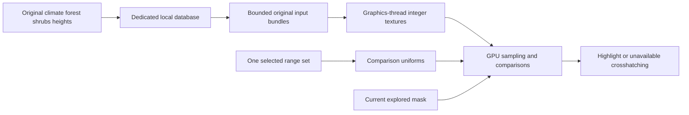

# GPU habitat evaluation

The CPU captures and persists original environmental arrays, reads immutable local snapshots and uploads integer textures. It does not sample terrain columns into suitability grids or generate overlay pixels. `GpuHabitatPreparation` owns bounded local reads and reusable upload bundles; `GpuHabitatOverlay` runs the comparison shader on the graphics thread.

## One selected criteria set

`HabitatRanges` contains one active min/max pair for temperature, rainfall, forest, shrubs and elevation, plus MinForestOrShrubs and one sampling convention. `From(HabitatRule)` copies an explicitly chosen definition set. It does not union ranges, combine alternatives or send species/rule arrays to the GPU. Species selection changes comparison uniforms while retaining environmental textures. The catalogue retains definition provenance separately; selection of its active set belongs to the controls.

## GPU sampling and output

Regional textures preserve original signed 32-bit climate/vegetation values in R32I. Heights use R16UI; explored coverage uses R8UI. Regional textures can be shared across terrain tiles; tile textures own heights and mutable coverage. Nearest filtering and texelFetch leave interpolation to the shader, which respects each source map's size and padding.

The shader samples generated maps with the active set's worldgen or ongoing-spawn convention. It uses the server temperature clamp, reference-height rainfall conversion, generated terrain height plus one, and normalized elevation. CPU-provided reference-height integers and conversion scale are world metadata, not per-column evaluation. The shader performs all habitat comparisons.

A known mismatch discards the fragment. Missing required inputs produce crosshatching; complete matching inputs produce the highlight. An unexplored column is discarded before comparison. The backend supplies display colors and retains the map scissor; the backend requires fullMapActive before drawing. GPU elevation arithmetic uses GLSL float; threshold precision requires numerical verification on supported hardware.

## Ownership and validity

`GpuHabitatPreparation` has no species input. Its count bounds are eight cached regions, 128 elevation records, 128 lightweight upload bundles and four pending read jobs plus one executing job. These are provisional retention/admission limits; representative workload tuning and GPU resource measurements remain pending. No per-column comparison batch or prepared suitability-mask cache exists on the CPU.

Committed storage updates invalidate only the affected source leases/bundles. View changes revoke old upload receipts while retaining sources. Consumers must call IsCurrent before uploading or publishing resources. Purge resets bundles and source leases. Session shutdown stops acquisition, joins local input work, drains persistent writes and closes storage.

GpuIntegerTexture, GpuRegionalTextures, GpuTileTextures and GpuHabitatOverlay allocate/dispose on the graphics thread. Upload preserves unpack alignment, row length, row/pixel skips, buffer and texture binding; drawing restores shader, texture units, blend, culling and depth state and preserves the caller's scissor/framebuffer. Reload replaces a linked program only on success.

The graphics backend is separate from map controls/resource caching. Full-map composer, coverage-adapter and resource-owner integration must supply current applicability, shared texture ownership and shader reload/disposal at their owning lifecycle boundaries. Focused tests establish input preservation and uniform forwarding. Rendering and resource lifecycle verification belongs to normal game integration; visual acceptance remains user-run.
