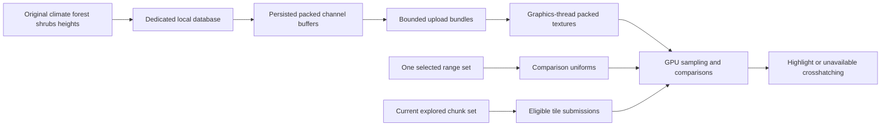

# GPU habitat evaluation

The CPU captures and persists original environmental arrays, packs channel buffers on the background storage worker, persists them and uploads those buffers as textures. It does not sample terrain columns into suitability grids or generate overlay pixels. `GpuHabitatPreparation` owns bounded reads of persisted channel buffers and reusable upload bundles; `GpuHabitatOverlay` runs the comparison shader on the graphics thread.

## One selected criteria set

`HabitatRanges` contains one active min/max pair for temperature, rainfall, forest, shrubs and elevation, plus MinForestOrShrubs and one sampling convention. `From(HabitatRule)` copies an explicitly chosen definition set. It does not union ranges, combine alternatives or send species/rule arrays to the GPU. Species selection changes comparison uniforms while retaining environmental textures. The catalogue retains definition provenance separately; the controls prefer ongoing-spawn ranges, fall back to worldgen ranges, and select a representative by ordinal entity code within the chosen path.

## GPU sampling and output

Each draw samples one regional RGBA8 UNORM atlas page and one terrain RG16UI atlas page, with independent pixel origins for their allocated rectangles. The regional RGBA8 UNORM texture stores raw temperature in R, rainfall in G, forest density in B and shrub density in A. Each source grid is copied into its channel without resampling. Grids with equal inner dimensions align their unpadded origins using per-channel upload offsets, allowing matching neighborhoods to share one RGBA lookup. The physical square fits the union of the shifted grids; original logical sizes and padding still bound every shader read. Climate's unused low byte is omitted only from the GPU representation. Forest and shrubs retain their full 0–255 densities. An unexpected out-of-range density makes only that component unavailable with a warning during background storage packing; it is never silently truncated or saturated. Original persisted arrays remain unchanged.

Each terrain RG16UI rectangle stores full unsigned 16-bit height in R and flags in G: bit 0 means height available, bit 1 known non-ocean, and bit 2 confirmed ocean. Zero ocean bits mean classification unavailable. Height zero remains valid when its availability bit is set. Exploration is not stored in this texture: the live explored-chunk draw list gates every submission, including cached resources after coverage removal. Packing values/categories does not evaluate habitat. Regional inputs are shared across terrain tiles. Interior adjacent sample neighborhoods use hardware linear filtering at explicit LOD zero. Neighborhoods touching the physical allocation edge use explicit corner reads, preventing normalized-coordinate rounding from reaching a neighboring slot. Matching neighborhoods reuse the returned RGBA value across channels; native ongoing-spawn climate/forest share returned RGBA samples and shrubs use a separate neighborhood. Worldgen chunk corners can skip intermediate shrub texels, so non-adjacent neighborhoods use four explicit corner reads with shader interpolation. Climate channels and ongoing vegetation are truncated back to whole-byte values after filtering; worldgen vegetation retains fractional density. UNORM/filter arithmetic can differ at exact thresholds because of hardware precision; source/unit checks do not establish bit-identical GPU interpolation. All habitat comparisons remain in the shader.

The shader samples generated maps with the active set's worldgen or ongoing-spawn convention. It uses the server temperature clamp, reference-height rainfall conversion, generated terrain height plus one, and normalized elevation. CPU-provided reference-height integers and conversion scale are world metadata, not per-column evaluation. The shader performs all habitat comparisons.

The overlay participates in native GUI depth testing and depth writes at Z=55, between terrain at Z=50 and prospecting/owned-creature markers at Z=60. It retains the caller's depth function and restores depth-test/write state after drawing. Discarded columns do not write depth.

A known mismatch discards the fragment. Missing required inputs produce crosshatching; complete matching inputs produce the highlight. Unexplored chunks never enter the draw list. Confirmed ocean is discarded before habitat sampling or crosshatching, even when height/climate/vegetation are missing. Unknown ocean classification contributes to unavailable-data output; known non-ocean includes freshwater and land below sea level. The backend supplies display colors and retains the map scissor; the presentation owner admits only active full-map explored tiles. Normalized elevation limits are converted once per criteria/world-geometry change into inclusive integer surface-height bounds using the server double-precision convention. The GPU samples terrain height plus one and compares it with those bounds, avoiding float division at elevation thresholds. This converts scalar criteria only; no terrain columns are sampled on the CPU.

## Ownership and validity

`GpuHabitatPreparation` has no species input. Its off-view cache floors are eight regional snapshots, 128 elevation records and 128 lightweight upload bundles. During rendering, retention expands to fit every currently visible explored chunk and its distinct regions, preventing still-visible inputs from being evicted at wider zooms. Admission remains four queued read jobs plus one executing job. Closing the map shrinks input retention back to the configured floors. Representative workload tuning and broader CPU/GPU performance acceptance remain pending; captured atlas page/binding/resource evidence is recorded separately in the implementation checklist. No per-column comparison batch or prepared suitability-mask cache exists on the CPU.

Committed storage updates invalidate only the affected source leases/bundles. View membership is separate from source and presentation-lifetime validity: panning and zooming retain current overlapping receipts and useful queued jobs. Consumers must call IsCurrent before uploading or publishing resources; this also checks membership in the latest explored view. Purge resets bundles and source leases. Session shutdown stops acquisition, joins local input work, drains persistent writes and closes storage.

GpuHabitatTexture, GpuRegionalTextures, GpuTileTextures and GpuHabitatOverlay allocate/dispose on the graphics thread. One lazy upload batch preserves unpack alignment, row length, row/pixel skips, pixel-unpack-buffer and current-unit texture binding across all new page allocations and rectangle transfers; one shared drawing pass restores shader, vertex-array/array-buffer bindings, texture units and sampler-object bindings, blend, culling and depth state and preserves the caller's scissor/framebuffer. After compilation, `GpuHabitatSamplers` queries the linked locations for both linked samplers (normalized regional and unsigned integer terrain) and completes the native uniform dictionary before ordinary engine texture binding. Reload replaces a linked program only after compilation and sampler registration succeed. A successful normal shader reload clears a presentation failure so drawing can resume.

The graphics backend is separate from map controls/resource caching. The native layer routes composition and rendering to the client presentation owner, which supplies current applicability, shared texture ownership and normal shader reload/disposal. The registration owner stops presentation before closing the client session, independent of leave-world subscriber ordering. Focused tests establish input preservation and uniform forwarding. Rendering and resource lifecycle verification belongs to normal game integration; visual acceptance remains user-run.

## Map presentation owners

`EcosystemMapSelection` places a localized None entry first and selects it initially, followed by sorted native localized species names. None produces no habitat draw and suspends disposable presentation work while keeping the dropdown available and acquisition active. Species or None selection survives composer replacement; a removed species returns to None. `EcosystemTabState` synchronizes only the ecosystem tab with its layer activation during composition, correcting vanilla's initial all-active tab defaults while retaining user choices on recomposition. `EcosystemMapControls` owns the extra panel and requires the exact composed full-map element. `MapComposerOwnership` detaches only that panel entry before disposal, using a checked adapter to the native collection; replacements remain untouched. `ExploredMapCoverage` reads only active vanilla terrain components and their public per-chunk flags, filtering them to the current view. It never opens the map database or treats visible coordinates alone as explored coverage.

`HabitatMapPresentation` polls bounded local preparation jobs without awaiting them inside rendering. It copies the native projection into a reusable owned 16-float buffer once per render before any tile draw: the installed native projection and model-view getters share scratch storage, so retaining their returned array across draws would overwrite the projection when model-view is read. The shared pass receives the stable projection snapshot and copies model-view into its own reusable buffer before binding both matrices. It rejects stale receipts before graphics publication and sends one selected criteria set to `HabitatMapGraphics`. That graphics owner retains atlas rectangles across species changes, sizing retention to the complete current explored view with eight regional/128 terrain entries as minimum cache capacities. View shrink releases excess off-view rectangles first; wholly empty pages are released during atlas maintenance. These capacities are provisional; they do not cap how much of the visible map can receive the overlay. Closing presentation revokes its lifetime, releases textures and cancels disposable jobs while acquisition and durable writes continue. `EcosystemMapClient` coordinates composer replacement, shader events and render-thread purge observation through these owners.
Inputs use their own linear regional and nearest terrain filtering during drawing; inherited sampler objects are cleared for the pass and restored afterward.

## Shared graphics pass

`HabitatMapGraphics` acquires all missing textures before opening a draw pass. No texture allocation, eviction or upload occurs inside the pass, so cached regional bindings remain valid. The pass captures caller state, suspends the previous shader, establishes common depth/blend/cull/sampler state and binds the criteria, scalar elevation bounds, world metadata, matrices and colors once. Tile draws update the terrain rectangle origin, screen bounds and world origin. Changed regional owners update the regional origin and independent channel layouts. Each sampler binds only on its first use in the pass or when its page changes; a view held in one page per format therefore needs two texture bindings for the pass. Only texture/sampler units 0 and 1 are touched and restored by the pass. Tracking resets for every pass. Empty or fully revoked ready sets open no pass, and disposal restores caller state once even when setup or drawing throws. Leases are checked after acquisition and before each submission.

## Incremental view retention

The current explored chunk set determines applicability; current screen positions and zoom arrive independently on every render. Changing that set updates membership without clearing receipts or replacing their lifetime token. Valid overlapping receipts remain drawable in the first changed-view frame. Entering tiles reuse retained bundles or enter the bounded local-read queue; no speculative prefetch or remote retrieval occurs. Departed tiles never reach upload or drawing. Retained off-view receipts can be reused on re-entry only while their exact source leases remain current.

Every source, bundle, receipt and texture cache installs the new visible working set before shrinking. Eviction selects off-view entries before protected visible entries, irrespective of LRU recency or upload order. Each LRU indexes off-view candidates in a second recency list, rebuilding that index once when the protected working set changes. Ordinary shrink/admission consumes candidates without repeatedly scanning the protected tail; hot lookups only update recency. Eviction still rechecks mutable protection. Independently invalidated leases absent from the index can require a fallback scan when indexed candidates are exhausted; invalid-source versus off-view disposal order is not a visibility guarantee. Source caches use coordinates; texture caches use coordinates plus the exact regional/tile source lease, excluding invalid leases from protection. Capacities are the maximum of configured floors and the finite visible working set. A late off-view admission can evict itself when all other entries are protected. Thus an unchanged visible input cannot be displaced by entering or obsolete work. Old invalid source textures remain disposable, never eligible for a current draw.

The queue still admits four waiting jobs and one executing job. Jobs check the presentation lifetime and current membership before starting, between regional and tile reads and before publication. Queued departed work completes without further reads; a tile that re-enters before those checks can use the original job. Presentation retains incomplete tasks across view transitions, observes completed off-view results without publishing them, and retries bounded admission on subsequent frames. A regional read already in progress may finish after departure, but cannot revoke protected inputs or publish an inapplicable result. Source updates, ocean updates, purge and world shutdown retain their independent validity checks.

Coverage removal is enforced by the current explored chunk set even when a source remains cached. Coverage re-entry with unchanged source provenance reuses the existing packed height/category textures; per-frame GPU comparisons and the shared graphics pass continue normally. Close clears disposable receipt/graphics ownership and revokes its lifetime, while local source retention returns to the configured floors. Reopen may reuse those packed source buffers but acquires fresh presentation resources. Shader reload does not invalidate environmental source identities.

## Packed input storage

Packing reduces each region from three texture objects to one and each tile from two to one. With native 20×20 climate, 17×17 forest and 33×33 shrub grids, padding alignment keeps the regional payload at 33×33×4 = 4,356 bytes. A 32×32 RG16UI terrain tile is 4,096 bytes; its 16-bit flags channel increases payload relative to separate R16UI height and R8UI coverage (3,072 bytes). These are format-derived payload sizes, excluding driver overhead, not measured frame-time or allocation savings. These are occupied source-rectangle payloads; physical atlas pages also reserve unused cells. Texture bindings change only when a sampler changes page, while draw submission remains per tile.

## Background channel packing

Storage/Packing owns CPU channel layout and versioned upload serialization. Source writes produce the packed region/tile buffers on EnvironmentalStorage's single background worker and save them atomically with merged originals. Upload reads normally decompress these buffers directly, without rebuilding channels or decoding original environmental arrays. A missing derived cache can be rebuilt only from supported local originals, also on that worker. GpuHabitatPreparation creates missing-source placeholders on its background job worker, outside its cache gate. Source leases, current explored membership and purge/session epochs still gate publication.

GpuRegionalTextures and GpuTileTextures accept ready-to-upload buffers; they perform no channel packing. The graphics thread retains GL allocation/upload/binding/disposal ownership. Removing packing from rendering does not establish that all loading or upload costs are resolved. Original arrays remain separately available for acquisition merges and exact persistence reads; GPU source caches retain packed layouts/bytes rather than a duplicate set of original arrays.

## Atlas allocation and sampling

HabitatAtlas owns separate format-specific page sets. The inspected installed TextureAtlasManager requires ClientMain and owns BGRA uploads, global texture positions and mipmaps; it cannot own feature-isolated RG16UI resources. Its public TextureAtlas allocator can be reused independently: NativeAtlasLayout reserves full rows in logical slot units with AllocateTextureSpace, then uses generation-stamped cells within those immutable rows. DisposePixels immediately releases the native constructor bitmap; using logical cell dimensions avoids allocating a full-pixel CPU mirror. Native row packing happens once per page rather than walking its non-coalescing allocation tree for each chunk. No private reflection or shared game atlas is used.

Pages group equal source-square sizes, preserving all channel padding and upload offsets. A page is sized to remaining retained demand, rounded to whole rows, with a provisional 4,096-pixel axis ceiling and the actual GL_MAX_TEXTURE_SIZE limit. An individual supported source larger than that ceiling gets its own hardware-bounded page. Existing pages never grow or relocate: demand expansion adds pages, and source eviction recycles cells with fresh generations. A partially occupied page remains allocated until its remaining sources leave; no compaction moves retained tiles. Hardware limits, differing regional sizes and fragmented retained pages can require multiple pages and page-driven rebindings. The historical 7,510-tile/86-region capture informs workload sizing, not a live atlas performance result or a final memory-budget acceptance.

The source-keyed LRUs retain off-view-first eviction. Atlas live-slot capacity follows those retention limits plus one transient replacement slot, permitting upload before eviction of an obsolete source lease. Slots and page metadata remain bounded by retained inputs and finite page geometry; unused cells and partially occupied pages can retain a larger high-water GPU allocation after zoom-in. Empty pages are trimmed on view-capacity changes and before creating another page. Close and purge invalidate all slots and dispose all pages. A released/recycled slot or cleared page cannot supply a texture ID. Shader reload preserves allocations and resets page-binding tracking at the next pass.

Only new or changed source rectangles use TexSubImage2D. Packing and Deflate decoding stay on workers; GL allocation, upload and disposal stay on the graphics thread and outside the draw pass. Both formats have only level zero. Regional sample bounds are checked against original logical grids before adding the atlas origin, and hardware linear sampling is used only with a full texel of allocation margin. Neighborhoods touching an allocation edge use exact texelFetch corner reads with shader interpolation, preventing neighboring-slot access even if normalized coordinates round. No guard-buffer generation or mip sampling is needed. Terrain uses exact integer texelFetch at column plus terrain origin. Existing ocean suppression, missing-data crosshatching, explored coverage, comparison ranges and native GUI depth/scissor behavior are unchanged. GpuHabitatUploads opens one graphics-thread acquisition scope and captures state only on the first allocation or transfer. Both formats then share that setup; cache-only batches issue no upload-state queries. Acquisition scope disposal restores caller state before draw setup, including after setup/allocation/transfer failure. Native texture operations never change the active texture unit. The graphics owner queries GL_MAX_TEXTURE_SIZE once at initialization. Upload admission budgets and draw submission batching remain separate planned work.
