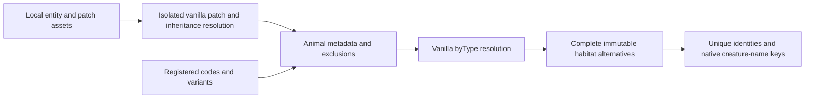

# Local ecosystem species catalogue

The catalogue discovers wildlife from installed entity definitions and registered entity codes/variants. There is no supported-species list, source-file list, domain restriction, or feature-owned species translation table. New local mod animals participate through the same metadata and spawning definitions.

## Discovery and exclusions

`EcosystemSpeciesCatalogue.Load` captures and patches private copies of local entity assets, expands inheritance through vanilla's merger, and resolves each registered entity's variants through vanilla's byType resolver. Definitions tagged as animals participate; fish categories, invertebrate/insect categories, monsters, rust creatures, mechanical entities, humanoids, inanimate objects, bots and domestic-only tags are excluded. Hostile spawning groups are retained because predators such as wolves and bears use them.

Stable identities first use resolved `attributes.ecosystemMap.speciesGroup` metadata when provided, qualified in the definition domain. Otherwise they use the definition domain, base code and semantic `type` variant. Age, gender and cosmetic variant dimensions do not create rows. When no type variant exists, the definition's handbook group joins separate young/sex source files, such as chicken and chicken-baby. Grouping uses metadata and variant values rather than translated text or suffix removal. Species without applicable environmental alternatives do not appear.

The engine does not expose a universal taxonomic species identifier. Definitions can supply speciesGroup metadata to combine breed/cosmetic types without restricting which animals are discovered. The shipped ecosystem-species-groups.json patch supplies this metadata for Angora, Nubian, Sirohi and Valais goat breeds, preserving distinct ibex, musk ox and other species. Other mods can use the same metadata for their own animals. Metadata is normalization data, not a supported-species list: definitions without it remain discoverable. Animal authors must supply meaningful classification metadata for exclusion rules to distinguish their wildlife from fish, insects or monsters.

## Native names

`Entity.GetName()` uses `Lang.GetMatching(domain + ":item-creature-" + entityCode)` for living creatures. The catalogue uses the same lookup with a deterministic representative rule-bearing entity. It neither creates a live entity nor activates its behaviors. Resolved attributes.ecosystemMap.nameKey can instead reference an existing game/mod species-group translation. Shipped goat grouping uses game:creaturegroup-goat. Existing game/mod translations provide all names, including their native wildcard fallback.

Vanilla entity names may include age or sex qualifiers. Those qualifiers do not create additional species entries; the catalogue does not strip translated text or manufacture replacement translations. `EntityProperties` has no equivalent species-only localized-name method.

## Rules and isolation

Private origin snapshots preserve archive support, vanilla overwrite order, local entity patches and inherited clauses. `LocalPatchApi` exposes only the getters used by vanilla's patcher; its target side is the entity definition category, while data/configuration/mod information comes from the local client. No server catalogue message or server API is required.

Each species retains immutable environmental alternatives and their entity-code/worldgen-or-runtime provenance. Shared climate overrides and defaults come from vanilla deserialization. Separate ranges are never widened; probability, population, light and other physical spawn checks do not become habitat clauses.

