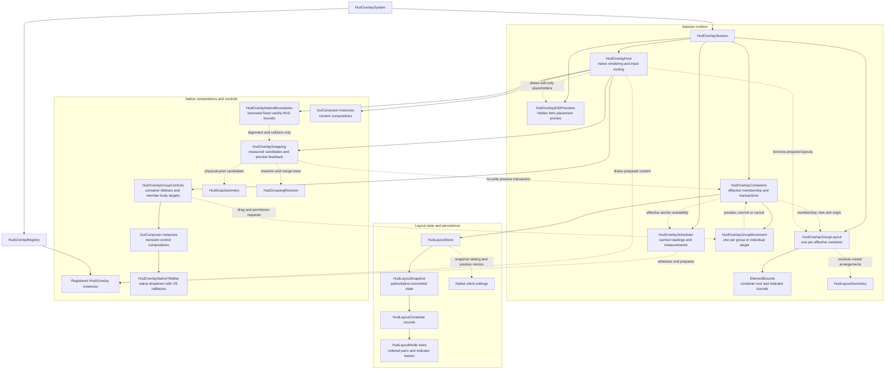

# HUD overlay integration

The HUD overlay system positions and updates passive displays on the client. An overlay supplies content and a measured footprint; the runtime handles anchoring, group layout, refresh scheduling, GUI scaling, and world-session transitions.

HUD containers use native hover titlebars while the cursor is free. Hover visible content, choose Movable from the native dropdown, and drag the container title area to move its members together. Dragging visible indicator content moves that individual through the same cancellable transaction; multi-member groups detach that indicator. Individual members expose no titlebar or dropdown; drag their visible content to detach them, and remaining members close the gap. Container titlebars provide the group menu and movement, including a singleton container's permission/reset access. Fixed locks both container dragging and individual detachment without changing position or membership. The close icon dismisses controls without disabling indicators. Reset HUD layout restores every built-in group and position, including retained overrides for unavailable integrations. No per-item or per-group reset is provided.

Effective membership is separate from feature registrations. Default templates, independent indicators, and saved custom containers share native bounds, clipping, and scheduler availability. Mixed arrangements use ordered horizontal/vertical pairs with start/center/end alignment. Size changes preserve relationships and container origin subject to screen clamping. Outside movement editing, hidden members collapse after their exit transition releases the footprint, retaining their saved relationships for reappearance.

Drag an indicator beside another to create a group or insert into its existing group. Drag a whole container beside another to merge their arrangements. All four sides support start, center, and end cross-axis alignment, chosen by pointer position. The preview highlights the destination and incoming content using the resulting mixed layout; grouping and alignment candidates that overlap visible indicators are rejected. Free drops that overlap visible indicators cancel without saving; Shift explicitly permits overlap. Fixed destinations accept incoming members while retaining their permission. Insertion grows the group toward the incoming item, preserving the opposite outer edge; left/top additions move its outer origin outward instead of pushing the destination away. Cross-axis growth preserves the chosen start, center, or end anchor. Native rounding and screen clamping still apply, and the preview and committed layout use the same adjusted origin. Hold Shift to bypass snapping and grouping. Matching edges, centers, and screen guides align placement without creating membership.

Snapping acquires within 16 physical pixels and retains a grouping target/member/side or alignment identity within 26 pixels. Valid nearby grouping candidates take priority over alignment guides, including retained screen guides. Within each intent, retained destinations take priority, then distance and ordinal identity. Crossing an alignment third does not release its grouping target: the previous alignment remains selected within a margin of min(6 physical pixels, target cross-span / 12), allowing deliberate changes without boundary jitter. Distances come from total pointer displacement rather than accumulated snap corrections. Screen guides and player-positioned containers use the actual viewport edges with no added screen inset; registered default placements keep their own configured padding. Preview geometry is reconciled with nearest-integer GUI-unit checkpoints and viewport clamping before release. Alignment guides move to the actual resolved position when native rounding shifts the ideal by at most one GUI unit; larger shifts and colliding layouts are rejected. Previews never write preferences or prepare feature artwork; a successful release commits membership and origins together.

Fixed vanilla HUD surfaces also supply alignment-only boundaries: the complete hotbar composer, health and hunger meter elements, and the temporal-stability gear's native hover area when enabled. The gear reference is its stable native interaction footprint, not a reconstruction of its animated artwork. Bounds are read through current open/enabled native compositions during dragging, including native GUI scaling and offsets; missing, dirty, invalid, ambiguous, hidden, or spectator HUDs provide no boundary. Ordinary windows and conditional oxygen/boss meters are excluded. Edge/center guides and outside-edge snaps use the existing acquisition, retention, rounding, clipping, and Shift policy. Native surfaces cannot join VE groups or acquire VE position keys. Drops that cover these surfaces are rejected unless Shift is held; successful alignment stores only the VE origin, without a persistent docking relationship.

The versioned JSON setting `vanillaexpanded:hud:layout` is authoritative for membership, permissions, layout trees, and integer GUI-unit origin checkpoints. Native dialog positions mirror that snapshot and are repaired from it. Legacy group origins migrate into Movable overrides; missing overrides retain registered defaults. Drops commit the snapshot before updating mirrors, cancellation never writes, and viewport clamping does not rewrite saved preferences. Malformed or newer snapshots remain untouched with defaults shown read-only until global reset. Layouts apply across worlds on the same client.

Titlebars occupy separate compositions above or below content and never change indicator measurements. Foreground dialogs take pointer priority; the HUD does not request a free cursor itself. Native focus transfer can unfocus another open window when a grip is clicked. Escape, cursor capture, hidden GUI, lost interaction, removal, and session exit cancel active dragging.

The hover titlebar is 22 GUI units high and shows its localized group name using normal HUD text; custom groups use the generic group label. Its drag area and native menu/close controls remain available. Its orange background uses the radial menu's hover palette, with native menu and close glyphs positioned for the slimmer bar. Hovering or interacting with the group shows a 45%-opacity orange panel behind its exact bounds. When the cursor is free and the group is Movable, an unfilled orange outline remains visible even away from hover. These decorations do not change group measurements or content positions. Foreground pointer ownership suppresses hover controls and fill, while the movable outline stays visible away from hover, including over unrelated windows. Hidden HUDs, a grabbed cursor, unavailable content, or modal input capture suppress the movement cue.

The temperature indicator keeps the same 36-unit height as the other status indicators. Warming chevrons stack vertically above the reading; cooling chevrons stack below it. The reading uses a 14-point font with native GUI scaling, using native scaling only, and fits within the remaining height. Chevrons draw at 12 × 7.5 GUI units for slightly heavier strokes. With the reading hidden, the chevrons retain their column beside the thermometer. Trend strength never adds height.

Reference `VanillaExpanded.dll` and the compatible Vintage Story API assemblies, and declare `vanillaexpanded` as a dependency in your mod metadata. `HudOverlaySystem`, `IHudOverlay`, registration and placement contracts, and the shared icon-and-text presentation are public and can be used from a separate mod assembly. Obtain the running system through the client mod loader; the game owns its lifetime.

When the cursor is free in a ready world with the global HUD enabled and visible, session-owned `HudOverlayEditPreviews` makes every registered item available for editing. Normal drawable content keeps its presentation. Hidden, disabled, inapplicable, empty, or failed content instead receives a compact labeled stand-in with full hidden-item identity on hover. Placeholders use their reserved footprint or the standard square size, and participate in the same effective layout, direct dragging, snapping, permissions, cancellation, and commit boundary. They never call hidden feature drawing/backdrops or invent readings, change enable toggles, or alter normal sampling. Unknown saved integrations without a registration have no placeholder.

Placeholder lettering prepares on the heartbeat and remains cached through frame layout and dragging. Mouse capture, hidden GUI, global HUD disabling, or loss of the ready session immediately removes edit targets; resources retire on the heartbeat or teardown. Normal visibility and transitions remain authoritative outside editing. If a default native anchor is missing, editing uses a transient screen fallback; only an explicit layout action persists it. Entering/exiting editing never writes preferences.

## Runtime structure

The session owns the runtime bindings; the registry retains feature ownership across sessions. Solid arrows show ownership or contained data. Dashed arrows show borrowed dependencies and calls.



Each effective container has one flat membership set. Its internal `HudLayoutNode` tree describes mixed horizontal/vertical arrangements, not nested movable groups. The runtime applies resolved geometry to native bounds; controls and persistence do not own feature artwork or duplicate overlay instances. A drag retains its base and preview layouts/compositions for reuse, while only the current preview participates in drawing and targeting. Release or cancellation retires the unused compositions.

## Registering an overlay

Implement `IHudOverlay` and register an instance through `HudOverlaySystem.Registry` during client startup, after the HUD system has registered its groups. Existing consumers use `ExecuteOrder() => 1` for this ordering.

A `HudOverlayRegistration` specifies:

- A unique namespaced ID, such as `example:status`.
- The overlay instance and a cheap enabled selector that reads the feature's current setting.
- An existing group ID.
- An integer display order and a positive refresh interval in milliseconds.
- Optional localization metadata for a hover title and a fixed footprint for a reserved slot.

The registry rejects duplicate IDs, unknown groups, and instances it already owns or has disposed. Successful registration transfers ownership of the overlay to the registry. Keep the returned `IDisposable` handle and dispose it when removing the integration. If registration fails, the caller still owns the instance and must clean it up.

For example, use this fragment in your client mod system, where `ExampleOverlay` implements `IHudOverlay` and `featureEnabled` is your setting:

```csharp
var hud = api.ModLoader.GetModSystem<HudOverlaySystem>();
var overlay = new ExampleOverlay();
IDisposable registration;
try
{
    registration = hud.Registry.Register(new HudOverlayRegistration(
        id: "example:status",
        overlay: overlay,
        isEnabled: () => featureEnabled,
        groupId: "player-status",
        order: 50,
        refreshIntervalMs: 1000,
        hoverLabelKey: "example:hud-status",
        reservedSize: new System.Drawing.SizeF(24, 24)));
}
catch
{
    overlay.Dispose();
    throw;
}
// Retain registration and dispose it when the integration is removed.
```

The fragment uses `VanillaExpanded.HudOverlays` and `VanillaExpanded.HudOverlays.Registration`. Placement types are in `.Anchoring`, packing types in `.Layout`, and `HudOverlayIconTextPresentation` in `.Rendering`. Registration and overlay callbacks run on the client main thread. Dispose your registration handle when unloading; the shared system and registry remain owned by VanillaExpanded.

## Implementing the lifecycle

A registered overlay may survive several world sessions. Keep session resources separate from the registration's lifetime.

| Method                                    | Integration responsibility                                                                                                                  |
| ----------------------------------------- | ------------------------------------------------------------------------------------------------------------------------------------------- |
| `BeginSession(api)`                       | Bind the current client world and subscribe to relevant events.                                                                             |
| `IsApplicable()`                          | Cheaply decide whether content can currently be sampled.                                                                                    |
| `Refresh()`                               | Capture a stable snapshot and report what changed.                                                                                          |
| `Prepare(context)`                        | Create or update presentation resources for that snapshot.                                                                                  |
| `Measure()`                               | Return finite, nonnegative `SizeF` dimensions in unscaled GUI units.                                                                        |
| `Draw(renderer, bounds, clip, deltaTime)` | Render prepared content within the supplied bounds and clip.                                                                                |
| `EndSession()`                            | Detach events, release owned session resources, and clear world references. Make this safe after partial initialization and repeated calls. |
| `Dispose()`                               | Perform final cleanup when the registration is removed.                                                                                     |

The registry calls `EndSession` before final disposal. Dispose resources allocated and owned by the overlay; retain the engine's ownership of borrowed services and cached assets. In particular, dropping a reference to an engine-cached texture does not require disposing that texture.

## Refreshing and drawing

`Refresh` returns `HudOverlayChange.None` for unchanged content, `Presentation` when visual resources need updating, and `Measurement` when the footprint must be measured again. Combine the flags when both change. The preparation context supplies the client API, GUI scale, locale, and font revision so presentation can adapt when those values change.

Periodic refreshes provide a fallback for data without reliable change events. For event-driven updates, call `hud.Invalidate(overlayId)` on the client main thread. Invalidation is coalesced into scheduled work; it does not refresh immediately inside the event callback. Keep subscriptions and gameplay sampling in the integration.

All built-in HUD indicators refresh their samples every 300 ms on the shared 100 ms heartbeat. Event-driven invalidations can refresh sooner; drawing and visibility animations continue each frame.

The environmental thermometer registers independently in `world-status` before the calendar and weather (order 99), refreshing every 300 ms. It samples `GetClimateAt(player.Pos.AsBlockPos, NowValues).Temperature` without body-temperature or heat-source adjustments. A 90 × 90 GUI-unit horseshoe liquid gauge spans −40°C to +60°C with an always-filled bulb. Liquid progresses clockwise from the lower-left to the lower-right. Five-degree ticks are prepared dynamically, and separate scale labels share the same angular calibration. The centered numeric reading uses the normal 14-point HUD font. Foreground clamps draw after the liquid and text. Missing or nonfinite climate hides it with the standard fade and collapse. `EnableEnvironmentalTemperatureOverlay` controls it independently of the clock.

Player wetness registers in `player-status` immediately before temperature (order 97). It reads the synchronized `wetness` attribute as a finite value from 0 to 1 and displays two fully filled slim blue drops. A centered whole-number percentage sits beneath the drops within the same 36-unit height. Nonzero wetness displays at least 1%; the artwork remains fully filled at every visible wetness level. Reading textures are cached until the displayed percentage or preparation context changes and are disposed with the presentation. Dry or unavailable values hide the indicator, releasing its footprint after the fade. The two transparent 128 × 128 PNG layers in `textures/hud/player-wetness` are loaded through the engine texture cache and reused for changing percentage readings. The engine owns GPU storage; world exit, removal, or a completed exit releases presentation bindings. `EnablePlayerWetnessOverlay` controls it live.

Drawing consumes the prepared snapshot. Avoid gameplay queries and resource creation in `Draw`. The supplied `clip` is in framebuffer pixels, while measurement and placement offsets use unscaled GUI units. Honor the clip for oversized content and restore any temporary render state. The runtime retries failed refresh or preparation work without interrupting other overlays.

## Choosing placement

An overlay registers with a default group template. A `HudOverlayGroup` defines its initial/reset placement and `HudOverlayPacking` policy. Register a group before registering its overlays; use a distinct group ID when the integration needs a separate default placement. `UpdateGroup` changes that template without replacing overlay instances or overriding explicit player layouts. Runtime membership may span any registered groups and is resolved separately from registration IDs.

`HudOverlayPlacement` defines the target, the attachment point on that target, the pivot on the group, and X/Y offsets. Available target IDs are `screen`, `hotbar`, and `saturation`. Attachment and pivot values come from `HudOverlayPoint`. For example, a target's `LeftBottom` attachment with a group's `RightBottom` pivot places the group to the target's left, aligned at the bottom, before offsets and viewport clamping.

Packing controls horizontal or vertical flow, spacing, padding, and cross-axis alignment. Members are ordered by ascending `Order`, then by ordinal overlay ID.

For a stable slot, supply a positive `reservedSize` in unscaled GUI units when registering the overlay. The effective container uses this footprint instead of the measured size while the overlay is drawable. Outside movement editing, hidden, disabled, inapplicable, empty, and failed members collapse according to visibility transitions, retaining their saved membership. Drawing still requires successfully prepared, visible content; a reservation alone exposes no hover target. Choose a footprint that accommodates the presentation's largest intended content and keep artwork at stable coordinates within the supplied bounds. Content exceeding the slot is clipped. Registrations without a fixed footprint use their measured size. Neither kind exposes invisible hover or drag targets; edit placeholders are explicitly prepared visible targets.

The built-in groups are:

| Group              | Intended use                                                                                                                                                                                                                                                       |
| ------------------ | ------------------------------------------------------------------------------------------------------------------------------------------------------------------------------------------------------------------------------------------------------------------ |
| `world-status`     | Vertical clock (order 98), radial environmental thermometer (order 99), calendar (order 100), and weather (order 101) indicators at the screen's top-right, inset 3 physical pixels independently of GUI scale. Hidden indicators collapse normally. |
| `player-status`    | Horizontal player status icons beside the hotbar's bottom-left edge.                                                                                                                                                                                               |
| `held-item-status` | Held-item information using the user's configured anchor and offsets.                                                                                                                                                                                              |

Registering with a shared default group adopts its initial placement and packing rules. Player-created attachments instead use the saved mixed arrangement and destination origin. Additional native HUD targets currently require extending the anchor resolver; there is no external anchor-registration API.

## Visibility and cleanup

The global HUD setting, the registration's enabled selector, applicability, and anchor availability determine visibility. A missing or hidden anchor hides its group without choosing a fallback location. The built-in indicators use their measured sizes and collapse after their exit transition finishes. The remaining indicators close the gaps while preserving their order. Custom fixed footprints stabilize drawable size but do not reserve empty space for hidden members.

Built-in indicators fade in and out over 250 ms. The temporal storm indicator instead flashes over one second on entry and exit, then resumes its normal urgency pulse when applicable. Foreground artwork, text, and backdrops share the transition opacity. Exiting indicators retain their last prepared content and footprint until the transition completes; reappearing content reverses the transition without releasing its artwork. Hiding the game's GUI or losing the anchor suppresses drawing immediately. World exit, registration removal, and disposal still release resources immediately.

An applicable overlay can return an empty footprint when it has nothing to show. This keeps it eligible for refreshes that may reveal content later. When visibility returns, the runtime refreshes content before drawing it.

Disabling a registration does not remove it or end its session. If disabling a feature should immediately release its resources, the integration must perform that cleanup as part of its own configuration handling. Existing integrations also invalidate their registration and call `hud.ConfigurationChanged()` to update visibility promptly.

Set the registration's optional `hoverLabelKey` to a namespaced localization key explaining what the indicator represents. The shared host resolves the label in the current language and displays a native tooltip when the mouse is free and over the indicator's visible footprint. Hidden, empty, clipped-out, or unavailable indicators expose no hover target.

Hover labels do not capture input or take focus. Feature overlays receive no mouse events or hover callbacks; the shared host routes input to native movement controls, eligible visible indicator bodies, and active dragging. Native chrome has priority; content dragging requires a free cursor, Movable permission, and no foreground window at the pointer. Empty group space is not a drag target.

Every built-in indicator has an independent style selector. Compact indicators use the `HudIndicatorStyle` enum (`Icon`, the default, or `Text`). Time, environmental temperature, and calendar use `EnvironmentalGaugeStyle`, which also supports `Immersive` and retains it as their default. JSON stores lowercase enum names; ConfigLib exposes mapped dropdowns. Undefined numeric enum values recover the corresponding default. Live style changes invalidate presentation and measurement even when the sampled value is unchanged. They do not change applicability, sampling, observation/drift, enable toggles, group ordering, or visibility transitions.

| Indicator | Configuration property | Text name | Retained reading |
| --- | --- | --- | --- |
| Bow ammunition | `BowAmmunitionIndicatorStyle` | `AMMO` | Eligible ammunition count, including zero |
| Body temperature | `BodyTemperatureIndicatorStyle` | `BODY` | Risk and trend; Celsius when its reading option is enabled |
| Player wetness | `PlayerWetnessIndicatorStyle` | `WET` | Whole percentage |
| Approximate time | `ApproximateTimeGaugeStyle` | `TIME` | Estimated day period |
| Environmental temperature | `EnvironmentalTemperatureGaugeStyle` | `TEMP` | Whole-degree local Celsius reading |
| Calendar | `CalendarDateGaugeStyle` | `DATE` | Three-letter localized month and native day |
| Weather | `WeatherConditionsIndicatorStyle` | `WTHR` | Independent weather bands |
| Rift activity | `RiftActivityIndicatorStyle` | `RIFT` | Native activity level |
| Temporal storm | `TemporalStormIndicatorStyle` | `STORM` | Storm stage, with the existing urgency pulse |

Text mode replaces artwork with a localized three-to-five-character name above the reading. Both lines use cached normal HUD text. The standard 36-unit height remains fixed; width expands to preserve the reading rather than shrinking it. No icon assets, instrument faces, liquid masks, or icon backdrops are prepared in text mode. Owned lettering is released after fade-out, style changes, API changes, or world exit. Storm text retains the same flashing entry/exit and imminent/waning pulse as its icon. Weather text uses `CLD0` through `CLD4` for cloud coverage and `CLD?` when coverage is unavailable; active precipitation names and `WND`, `FOG`, and `THR` carry intensity suffixes 1–3. This preserves simultaneous weather channels rather than selecting only the dominant condition.

The eight stateful indicator presentations derive from `HudIndicatorPresentation<TStyle>`. The base owns enum validation and style switching, the prepared context and size, cached text-mode rendering, and the shared visibility/reset/dispose lifecycle. Feature implementations provide `ReleaseArtwork` and `ClearContent` separately: switching styles releases only presentation resources, while a completed exit or world reset also clears sampled content and feature timers. This keeps storm urgency timing and sampled readings intact during style changes. Each subclass retains its artwork loaders, native resource ownership, measurement details, and draw order. Text and artwork helper classes keep their narrower ownership contracts rather than inheriting the indicator lifecycle.

Icon style displays a 36 × 36 time-period symbol using the existing dawn/morning/noon/afternoon/dusk/night artwork. Temperature and calendar use a 24-unit symbol beside ordinary 14-point HUD text in a 96 × 36 footprint. Temperature retains the whole-degree Celsius reading, including values outside the instrument scale. Calendar retains the three-letter localized month and native day. The thermometer and calendar SVG symbols are rasterized once into owned textures and use the common trilinear filtering. PNG time icons remain borrowed from the engine cache. Compact text and SVG textures are released after fade-out, style changes, API rebinding, or world exit. Copper instruments and their mechanical resources are not prepared while icon style is active. The detailed instrument composition below describes immersive style.

The approximate-time indicator uses a copper radial dial with 24 runtime-colored hourly segments and an independently rotating pointer. Noon is at the top, 18:00 at the right, midnight at the bottom, and 06:00 at the left. The face uses the native calendar sun-position model at the player location across the represented day: daylight above the horizon, dawn/dusk between the horizon and −6° solar elevation, and night below −6°. Rising and setting samples distinguish dawn from dusk. Each hour blends twelve five-minute phase samples. Polar days and nights retain their actual distributions. Invalid samples retain the last valid distribution or the initial neutral face.

The pointer retains synchronized approximate-time drift and refreshes every 300 ms. The daily phase distribution is cached by day, player block position, and seasonal override. Face pixels are replaced only when their colors change. The pointer rotates through the standard textured GUI renderer using a model-view transform around its registered spindle. The enclosing matrix is restored after drawing, and the spindle remains fixed when the clock size changes. The foreground glass draws last. Calendar and temperature sampling are independent of clock drift and visibility.

The calendar registers after temperature (order 100), refreshing every 300 ms. It reads the native day-of-year, days-per-month, and month name. Two recessed rollers show three-letter localized month / day in a compact 96 × 36 GUI-unit housing. Lettering is cached until content or preparation context changes, centered within registered windows, and drawn before the glass. `EnableCalendarDateOverlay` controls it independently; hidden instruments collapse normally.

All three instruments use their complete texture canvases, including transparent margins. Coordinates for subregions scale from those canvases through the current palette size and native GUI scale. `HudOverlaySizes.Clock`, `EnvironmentalThermometer`, and `Calendar` define their absolute GUI-unit widths; the rectangular instruments preserve their texture aspect ratios. Each instrument draws its backing (layer 0), live readings and mechanisms (layer 1), then foreground clamps or glass (layer 2). Registered subregion coordinates are defined alongside their rendering code. Live appearance and GPU rendering require in-game verification.

HUD artwork, cached readings, runtime face/tick textures, and uploaded icon backgrounds use mipmaps and trilinear minification with linear magnification through `HudOverlayTextureFiltering`. The helper restores the prior texture binding. Engine-cached artwork remains engine-owned; each presentation releases its owned lettering, face, and tick textures after completed fade-out or world exit. Native item icons retain the engine item renderer and shared atlases.

Radial instruments share the exact 512 × 512 housing backing and foreground glass in `textures/hud/workshop-gauges/radial/layer-0.png` and `layer-2.png`. Their aperture and center registration are defined by `RadialGaugeLayout`. The clock supplies its own runtime face and pointer. The thermometer supplies isolated empty/full glass and clamp mechanisms in its own asset folder, fitted uniformly within that shared aperture. The calibrated arc runs from 150° through 390° in screen coordinates about the canvas center; −40°C and +60°C map to its endpoints and 0°C to 40 percent travel. All thermometer mechanism and scale coordinates map through the same inset bounds, centered on the shared housing aperture. The full sprite is decoded once per API binding, and only its alpha is masked by angular progress. An owned GPU texture is updated in place when bounded fill changes, then its mipmaps are rebuilt; source RGB and glass highlights remain unchanged. An antialiased reveal edge and an always-filled bulb/neck preserve continuity. Drawing uses the standard GUI renderer and host clip without gameplay queries. Clamps draw over the mechanism, then the shared foreground glass draws last. Reset releases the owned mask pixels, GPU texture, ticks, and reading.
